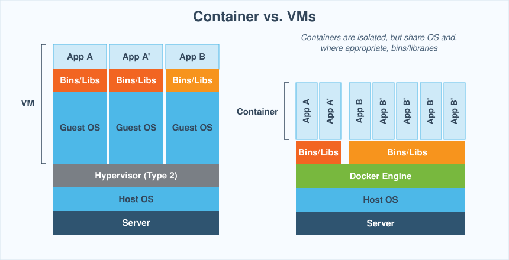

# Week 9 Lecture: Containers with Docker

Follow this guide from top to bottom. You type every command in a real terminal **on your own laptop**. You need nothing else: no server, no lab machine, no cloud account. Install Docker first (see "How to install Docker" below).

## How to follow this guide

- Every grey box is **one command** (or one file you create). Everything after the `#` on the first line is a comment that says what the command does. Copy the whole box, paste it into the terminal, press Enter, then go to the next box.
- **You should see** shows roughly what the terminal prints. IDs and times will differ.
- Do the steps in order. Each step builds on the one before.
- Steps and subsections marked **REFERENCE** are not presented in class. The full detail stays here for you to read on your own, and the lab practises it.
- All practice work happens in one folder, `~/container-practice`.
- **Which box to use:** where a command differs by system, you get two boxes: **Windows (PowerShell)**, open by default, and **macOS / Linux (Terminal)**, collapsed. Click a title to open or close its box. Most `docker` commands are identical on every system, so they get one box. The exceptions are commands that mount your current folder (`-v "$PWD":/app`): the folder variable is written differently in PowerShell.

**How to install Docker.** Download and install **Docker Desktop** from <https://www.docker.com/products/docker-desktop/>. It includes Docker Engine, the `docker` command and Docker Compose.

- **Windows:** run the installer and keep **Use WSL 2** switched on. Restart if it asks.
- **macOS:** choose **Apple chip** or **Intel chip** to match your Mac (Apple menu > About This Mac). Drag Docker to Applications.

Open Docker Desktop, accept the prompts, and wait until it says it is running. Keep it running whenever you use Docker.

**Linux users:** do not use Docker Desktop. Install Docker Engine by following <https://docs.docker.com/engine/install>, then run `sudo usermod -aG docker $USER` and reopen the terminal.

Check that Docker works. Docker Desktop must be open. In a terminal run:

```bash
docker --version
```

```bash
docker run --rm hello-world
```

`docker --version` prints the Docker version (any recent version is fine). `docker run --rm hello-world` downloads a tiny test image, runs it once, and deletes the container afterwards (`--rm`).

**You should see** a message that starts with `Hello from Docker!`. If you see `Cannot connect to the Docker daemon`, Docker is not running: start Docker Desktop.

**Linux:** if a `docker` command says `permission denied`, you skipped `sudo usermod -aG docker $USER` in the install step. Run it and open a new terminal. You never need `sudo` in this guide.

## The big picture

Your Python script runs on your laptop. It fails on the server: wrong Python version, a missing library, a different operating system. "It works on my machine" is the oldest problem in operations. A **container** solves it: you ship the program **together with everything it needs**, and it runs the same everywhere.

**Container or virtual machine?**

| | Virtual machine | Container |
|---|---|---|
| Contains | A full operating system, kernel included | Only the program and its libraries |
| Shares | Nothing (hardware is emulated) | The kernel of the host |
| Size | Gigabytes | Megabytes |
| Starts in | Minutes | Seconds or less |
| Isolation | Strong | Good, but weaker than a VM |



A container is not a small VM. It is a normal process that the kernel isolates, so it sees its own files, its own network and its own process list.

**Container Terminologies**

| Word | Meaning |
|---|---|
| **Image** | A read-only package: files, libraries and the command to start. Like a class. |
| **Container** | A running (or stopped) instance of an image. Like an object. |
| **Registry** | A server that stores images. Docker Hub (`hub.docker.com`) is the public one. |
| **Dockerfile** | A text recipe that builds an image, one instruction per line |
| **Volume** | Storage that lives outside the container, so data survives when the container is deleted |
| **Network** | A virtual network that containers join to talk to each other by name |
| **Compose** | A YAML file that describes several containers and starts them together |

**Image and container**

```text
Dockerfile  --docker build-->  image  --docker run-->  container
 (recipe)                      (package)               (running process)
```

One image can start many containers. Deleting a container does not delete the image. **Data written inside a container is lost when the container is deleted.** Volumes fix that (see Volumes below).

## Getting started

Two commands to explore Docker before you run anything:

```bash
docker info
```

`docker info` shows details about your Docker installation: the version, how many containers and images you have, and the system Docker runs on. It also confirms that Docker is running.

```bash
docker help
```

`docker help` lists all Docker commands. Add `--help` to any command to see its options, for example `docker run --help`. Use it whenever you forget how a command works.

## Pull an image and run a test

```bash
docker pull hello-world
```

```bash
docker run hello-world
```

```bash
docker ps
```

```bash
docker ps -a
```

| Command | What it does |
|---|---|
| `docker pull hello-world` | Download the `hello-world` image from the registry (Docker Hub). |
| `docker run hello-world` | Create a container from the image and start it. |
| `docker ps` | List **running** containers. Same as `docker container ls`. |
| `docker ps -a` | List **all** containers, including stopped ones. Same as `docker container ls -a`. |

**You should see** a message that starts with `Hello from Docker!`. Then `docker ps` shows nothing: the program printed its message and ended, so the container stopped. `docker ps -a` still lists it, with the status `Exited`.

## Run an environment

Start a container from an Ubuntu image and work inside it:

```bash
docker run -it ubuntu bash
```

`-it` connects your keyboard to the container (**i**nteractive, with a **t**erminal). Your prompt changes: you are now **inside** the container. Try:

```bash
cat /etc/os-release && whoami && hostname
```

You see Ubuntu, then `root`, then the container ID. You are `root` on Ubuntu, whatever laptop you use. You see only the container's own files. Leave the container:

```bash
exit
```

The container stops when you leave, because `bash` was its only process.

## Running applications

Start the nginx web server:

```bash
docker run nginx:alpine
```

The terminal is now busy showing nginx's log. Press **Ctrl+C** to stop it. Now run it in the background with `-d` (detached):

```bash
docker run -d nginx:alpine
```

```bash
docker ps
```

nginx runs, but you cannot reach it from your browser yet: no port is connected to your laptop. Docker picked a random name for the container (see the `NAMES` column). Delete it, replacing `NAME` with that name:

```bash
docker rm -f NAME
```

Start it again with a name of your own and a published port:

```bash
docker run -d --name web1 -p 8081:80 nginx:alpine
```

| Part | Meaning |
|---|---|
| `-d` | **d**etached: run in the background |
| `--name web1` | Give the container a name you can use later |
| `-p 8081:80` | **p**ublish: `HOST_PORT:CONTAINER_PORT`. Port 8081 of your laptop goes to port 80 inside the container. |
| `nginx:alpine` | The image. `nginx` is the name, `alpine` is the **tag** (a version label, here a small Linux base). |

Open <http://localhost:8081> in your browser. **You should see** a page that says `Welcome to nginx!`.

Delete the web server:

```bash
docker rm -f web1
```

## Stop and start a container

Start a database. The image is large, so the first download takes a minute:

```bash
docker run --name my_mongo -d mongo:noble
```

Here `mongo` is the image and `noble` is the tag (the Ubuntu version it is built on). Open a shell inside the running container:

```bash
docker exec -it my_mongo sh
```

`docker exec` runs a command inside a container that is already running. Try `ls /` and `hostname`, then:

```bash
exit
```

This time the container keeps running, because `exit` ended only the shell you started with `exec`, not the database.

Now stop and start it:

```bash
docker stop my_mongo
```

```bash
docker start my_mongo
```

```bash
docker restart my_mongo
```

```bash
docker rm -f my_mongo
```

| Command | What it does |
|---|---|
| `docker stop NAME` | Stop a container. It still exists (`docker ps -a` shows `Exited`). |
| `docker start NAME` | Start a stopped container again. |
| `docker restart NAME` | Stop and start in one command. |
| `docker rm -f NAME` | Stop (`-f`) and delete a container. The image stays on your disk. |

Also useful: `docker rm NAME` (without `-f`) deletes a container that is already stopped.

## Inspect a running container

Start a database with an environment variable. `-e` sets a variable inside the container. The image is large, so the first download takes a minute (skip the download if you already pulled it):

```bash
docker run --name my_mongo -e MY_ENV_VAR=my_env_val -d mongo:noble
```

Open a bash shell inside it and read the variable:

```bash
docker exec -it my_mongo bash
```

```bash
echo $MY_ENV_VAR
```

```bash
exit
```

**You should see** `my_env_val`. Now look at the container from outside:

```bash
docker stats my_mongo
```

```bash
docker logs my_mongo
```

```bash
docker top my_mongo
```

```bash
docker inspect my_mongo
```

```bash
docker port my_mongo
```

| Command | What it does |
|---|---|
| `docker stats my_mongo` | Live CPU, memory, network and disk use of the container. Press **Ctrl+C** to stop. `docker stats` with no name shows all running containers. |
| `docker logs my_mongo` | Display the output and error messages generated by the container. |
| `docker top my_mongo` | Display the processes currently running inside the container. |
| `docker inspect my_mongo` | Display detailed configuration and runtime information: state, network settings, mounts and metadata. The output is long (JSON). |
| `docker port my_mongo` | Display the port mappings between your laptop and the container. It prints nothing here, because this container has no published port (`-p`). |

Delete the container:

```bash
docker rm -f my_mongo
```

## Try it yourself

Run this and explain what happens:

```bash
docker run -it alpine bash
```

Alpine has no `bash`. What can you do instead?

<details>
<summary>Answer</summary>

Docker prints an error like `exec: "bash": executable file not found`, and the container exits at once. Alpine is a very small Linux and ships only the simpler shell `sh`. A container contains only what its image contains, so run:

```bash
docker run -it alpine sh
```

Type `exit` to leave.

</details>

## Images and tags

An image name has the form `NAME:TAG`. **Always use a tag.** If you leave it out, Docker uses `latest`, which changes over time and makes your builds unpredictable.

Download two Python images without running them. They have the same name and different tags:

```bash
docker pull python:3.11-slim
```

```bash
docker pull python:3.12-slim
```

List the images on your computer:

```bash
docker image ls
```

```bash
docker images
```

Both commands do the same. You see the repository name, the tag, the **IMAGE ID**, when it was created and its size.

Run the same program, `python`, in each image. Only the tag differs. `--rm` deletes the container when the command ends:

```bash
docker run --rm python:3.11-slim python --version
```

```bash
docker run --rm python:3.12-slim python --version
```

Show the details of an image: its layers, environment variables, the command it starts, and more. The output is long (JSON):

```bash
docker inspect python:3.11-slim
```

**Remove an image.** Remove an image by name and tag:

```bash
docker rmi python:3.12-slim
```

You can also remove an image by its **IMAGE ID**. Copy the ID from `docker images` and replace `IMAGE_ID`:

```bash
docker rmi IMAGE_ID
```

`docker rmi` is the same as `docker image rm`. Run `docker images` again: the image is gone from your disk. Docker refuses to remove an image that a container still uses. Add `-f` to force it.

**Tag an image.** A tag gives an image another name. Replace `YOUR_USERNAME` with your Docker Hub user name (create a free account at <https://hub.docker.com> first):

```bash
docker image tag python:3.11-slim YOUR_USERNAME/python:3.11-slim
```

```bash
docker images
```

**You should see** the same IMAGE ID under two names, `python:3.11-slim` and `YOUR_USERNAME/python:3.11-slim`. A tag is a label, not a copy: no extra disk space is used.

**Push an image to Docker Hub.** Log in. Docker asks for your Docker Hub user name and password, or opens your browser to confirm:

```bash
docker login
```

Upload the image to your profile:

```bash
docker push YOUR_USERNAME/python:3.11-slim
```

**You should see** the layers upload. Open <https://hub.docker.com> and find `python` in your repositories. Anyone can now run `docker pull YOUR_USERNAME/python:3.11-slim`. The name must start with your user name, which is why you tagged the image first.

| Command | What it does |
|---|---|
| `docker image ls` / `docker images` | List the images on your computer |
| `docker pull NAME:TAG` | Download an image without running it |
| `docker inspect NAME:TAG` | Show the details of an image (or of a container) |
| `docker rmi NAME:TAG` or `docker rmi IMAGE_ID` | Remove an image (same as `docker image rm`) |
| `docker image tag SOURCE[:TAG] TARGET[:TAG]` | Give an image another name |
| `docker login` | Authenticate with Docker Hub |
| `docker push NAME:TAG` | Upload an image to Docker Hub |

**Try it yourself: same script, different Python version**

> **REFERENCE** Not presented in class. Try it on your own.

An image is a ready-made environment. To see that, run one small Python script in two different Python images. The script prints a cow that says which Python and which operating system it runs on. It uses a third-party library, `cowsay`.

<details>
<summary>macOS / Linux (Terminal)</summary>

```bash
mkdir -p ~/container-practice/demo && cd ~/container-practice/demo
```

</details>

<details open>
<summary>Windows (PowerShell)</summary>

```powershell
New-Item -ItemType Directory -Force ~/container-practice/demo | Out-Null
Set-Location ~/container-practice/demo
```

</details>

<details>
<summary>macOS / Linux (Terminal)</summary>

```bash
cat > demo.py <<'EOF'
import platform
import cowsay

cowsay.cow(f"I run on Python {platform.python_version()} on {platform.system()}")
EOF
```

</details>

<details open>
<summary>Windows (PowerShell)</summary>

```powershell
@'
import platform
import cowsay

cowsay.cow(f"I run on Python {platform.python_version()} on {platform.system()}")
'@ | Set-Content demo.py -Encoding ascii
```

</details>

Run the file in a container with Python 3.11. `-v` shares the current folder with the container and `-w` sets the folder to work in:

<details>
<summary>macOS / Linux (Terminal)</summary>

```bash
docker run --rm -e PIP_ROOT_USER_ACTION=ignore -v "$PWD":/app -w /app python:3.11-slim sh -c "pip install -q cowsay && python demo.py"  # Start a Python 3.11 container, mount this folder as /app, install the library inside the container, and run the script.
```

</details>

<details open>
<summary>Windows (PowerShell)</summary>

```powershell
docker run --rm -e PIP_ROOT_USER_ACTION=ignore -v "${PWD}:/app" -w /app python:3.11-slim sh -c "pip install -q cowsay && python demo.py"  # Start a Python 3.11 container, mount this folder as /app, install the library inside the container, and run the script.
```

</details>

**You should see** a cow that says `I run on Python 3.11.x on Linux`. Your laptop is untouched: the library exists only inside that container, and the container is deleted when the script ends (`--rm`).

Run it again with a different Python version. Only the image tag changes:

<details>
<summary>macOS / Linux (Terminal)</summary>

```bash
docker run --rm -e PIP_ROOT_USER_ACTION=ignore -v "$PWD":/app -w /app python:3.12-slim sh -c "pip install -q cowsay && python demo.py"  # Same script, Python 3.12.
```

</details>

<details open>
<summary>Windows (PowerShell)</summary>

```powershell
docker run --rm -e PIP_ROOT_USER_ACTION=ignore -v "${PWD}:/app" -w /app python:3.12-slim sh -c "pip install -q cowsay && python demo.py"  # Same script, Python 3.12.
```

</details>

The cow now reports Python 3.12. One file, two Python versions, no installation on your laptop.

## Build your own image with a Dockerfile

Create a small website and a Dockerfile in a new folder:

<details>
<summary>macOS / Linux (Terminal)</summary>

```bash
mkdir -p ~/container-practice/site && cd ~/container-practice/site  # Create the folder for this image and move into it.
```

</details>

<details open>
<summary>Windows (PowerShell)</summary>

```powershell
New-Item -ItemType Directory -Force ~/container-practice/site | Out-Null
Set-Location ~/container-practice/site  # Create the folder for this image and move into it.
```

</details>

<details>
<summary>macOS / Linux (Terminal)</summary>

```bash
cat > index.html <<'EOF'
<h1>Bytown NetOps</h1>
<p>Built by me, served from a container.</p>
EOF
```

</details>

<details open>
<summary>Windows (PowerShell)</summary>

```powershell
@'
<h1>Bytown NetOps</h1>
<p>Built by me, served from a container.</p>
'@ | Set-Content index.html -Encoding ascii
```

</details>

<details>
<summary>macOS / Linux (Terminal)</summary>

```bash
cat > Dockerfile <<'EOF'
FROM nginx:alpine
COPY index.html /usr/share/nginx/html/index.html
EXPOSE 80
EOF
```

</details>

<details open>
<summary>Windows (PowerShell)</summary>

```powershell
@'
FROM nginx:alpine
COPY index.html /usr/share/nginx/html/index.html
EXPOSE 80
'@ | Set-Content Dockerfile -Encoding ascii
```

</details>

The three lines of the Dockerfile:

| Instruction | Meaning |
|---|---|
| `FROM nginx:alpine` | Start from this existing image |
| `COPY index.html ...` | Copy a file from your folder into the image |
| `EXPOSE 80` | Document that the program listens on port 80 (it does not publish it) |

Build and run it:

```bash
docker build -t site:1.0 .  # Build an image from the Dockerfile in this folder (.) and name it site:1.0.
```

```bash
docker run -d --name site1 -p 8082:80 site:1.0  # Start a container from your image on port 8082.
```

Open <http://localhost:8082> in your browser. **You should see** your own page: "Bytown NetOps".

Each instruction in the Dockerfile became a **layer** of the image. Show the layers:

```bash
docker history site:1.0
```

**You should see** one line per layer. The `COPY index.html` layer is yours, and the layers below it come from `nginx:alpine`. Docker reuses layers that did not change, which makes rebuilds fast.

Change the page and build version 1.1. Docker reuses unchanged layers, so this is fast:

<details>
<summary>macOS / Linux (Terminal)</summary>

```bash
echo "<p>Version 1.1</p>" >> index.html  # Add a line to the page.
```

</details>

<details open>
<summary>Windows (PowerShell)</summary>

```powershell
Add-Content index.html "<p>Version 1.1</p>"  # Add a line to the page.
```

```bash
docker build -t site:1.1 .  # Build again. Lines that did not change say CACHED.
```

```bash
docker rm -f site1  # Delete the old container.
```

</details>

**More Dockerfile instructions**

> **REFERENCE** Read it on your own; the lab uses them.

| Instruction | Meaning |
|---|---|
| `ARG NAME` | A value you pass at build time with `--build-arg NAME=value` |
| `ENV NAME=value` | An environment variable inside the container |
| `LABEL key=value` | Metadata stored on the image |
| `WORKDIR /app` | Set the working folder for the next instructions |
| `RUN command` | Run a command **while building** (install packages) |
| `CMD ["cmd", "arg"]` | The command that runs **when the container starts** |

## Package a Python web app

> **REFERENCE** Not presented in class. Read it on your own; the lab practises it.

Now you package a real program: a small Python web service that reports which container answered and counts the visits.

<details>
<summary>macOS / Linux (Terminal)</summary>

```bash
mkdir -p ~/container-practice/pyapp && cd ~/container-practice/pyapp  # Create the folder for the app and move into it.
```

</details>

<details open>
<summary>Windows (PowerShell)</summary>

```powershell
New-Item -ItemType Directory -Force ~/container-practice/pyapp | Out-Null
Set-Location ~/container-practice/pyapp  # Create the folder for the app and move into it.
```

</details>

<details>
<summary>macOS / Linux (Terminal)</summary>

```bash
cat > app.py <<'EOF'
import os
import platform
import socket

from flask import Flask, jsonify

app = Flask(__name__)
COUNT_FILE = os.environ.get("COUNT_FILE", "/data/count.txt")
GREETING = os.environ.get("GREETING", "Hello from Bytown NetOps")


def next_count():
    os.makedirs(os.path.dirname(COUNT_FILE), exist_ok=True)
    try:
        with open(COUNT_FILE) as f:
            count = int(f.read())
    except (FileNotFoundError, ValueError):
        count = 0
    count += 1
    with open(COUNT_FILE, "w") as f:
        f.write(str(count))
    return count


@app.get("/")
def index():
    return jsonify(
        message=GREETING,
        container=socket.gethostname(),
        python=platform.python_version(),
        visits=next_count(),
    )


if __name__ == "__main__":
    app.run(host="0.0.0.0", port=8000)
EOF
```

</details>

<details open>
<summary>Windows (PowerShell)</summary>

```powershell
@'
import os
import platform
import socket

from flask import Flask, jsonify

app = Flask(__name__)
COUNT_FILE = os.environ.get("COUNT_FILE", "/data/count.txt")
GREETING = os.environ.get("GREETING", "Hello from Bytown NetOps")


def next_count():
    os.makedirs(os.path.dirname(COUNT_FILE), exist_ok=True)
    try:
        with open(COUNT_FILE) as f:
            count = int(f.read())
    except (FileNotFoundError, ValueError):
        count = 0
    count += 1
    with open(COUNT_FILE, "w") as f:
        f.write(str(count))
    return count


@app.get("/")
def index():
    return jsonify(
        message=GREETING,
        container=socket.gethostname(),
        python=platform.python_version(),
        visits=next_count(),
    )


if __name__ == "__main__":
    app.run(host="0.0.0.0", port=8000)
'@ | Set-Content app.py -Encoding ascii
```

</details>

<details>
<summary>macOS / Linux (Terminal)</summary>

```bash
echo "flask==3.0.3" > requirements.txt  # List the libraries the app needs, with fixed versions.
```

</details>

<details open>
<summary>Windows (PowerShell)</summary>

```powershell
Set-Content requirements.txt "flask==3.0.3" -Encoding ascii  # List the libraries the app needs, with fixed versions.
```

</details>

<details>
<summary>macOS / Linux (Terminal)</summary>

```bash
cat > Dockerfile <<'EOF'
FROM python:3.11-slim
WORKDIR /app
COPY requirements.txt .
RUN pip install --no-cache-dir -r requirements.txt
COPY app.py .
ENV GREETING="Hello from Bytown NetOps"
EXPOSE 8000
CMD ["python", "app.py"]
EOF
```

</details>

<details open>
<summary>Windows (PowerShell)</summary>

```powershell
@'
FROM python:3.11-slim
WORKDIR /app
COPY requirements.txt .
RUN pip install --no-cache-dir -r requirements.txt
COPY app.py .
ENV GREETING="Hello from Bytown NetOps"
EXPOSE 8000
CMD ["python", "app.py"]
'@ | Set-Content Dockerfile -Encoding ascii
```

</details>

Read the Dockerfile from the top: start from Python 3.11, work in `/app`, copy the library list, install the libraries, copy the program, set a default greeting, and start the program when a container starts. The library list is copied **before** the program on purpose: Docker caches each layer, so the slow `pip install` runs again only when `requirements.txt` changes.

```bash
docker build -t bytown-py:1.0 .  # Build the image. The first build downloads Flask and takes a minute.
```

```bash
docker run -d --name py1 -p 8090:8000 bytown-py:1.0  # Start a container from the image on host port 8090.
```

<details>
<summary>macOS / Linux (Terminal)</summary>

```bash
curl -s http://localhost:8090  # Call the app.
```

</details>

<details open>
<summary>Windows (PowerShell)</summary>

```powershell
curl.exe -s http://localhost:8090  # Call the app.
```

</details>

**You should see** JSON with `"message": "Hello from Bytown NetOps"`, the Python version, a `container` value (a short hex ID) and `"visits": 1`. Run the `curl` again: the visits go up.

One image starts many containers. Start a second one with a different greeting:

```bash
docker run -d --name py2 -p 8091:8000 -e GREETING="Hello from container two" bytown-py:1.0  # A second container from the same image. -e overrides the greeting.
```

<details>
<summary>macOS / Linux (Terminal)</summary>

```bash
curl -s http://localhost:8091  # The container ID and the greeting differ from py1, and the visits start at 1.
```

</details>

<details open>
<summary>Windows (PowerShell)</summary>

```powershell
curl.exe -s http://localhost:8091  # The container ID and the greeting differ from py1, and the visits start at 1.
```

</details>

Each container has its own ID, its own environment and its own counter file. Now look at the logs and prove the build cache:

```bash
docker logs py1  # The app prints one line per request it received.
```

<details>
<summary>macOS / Linux (Terminal)</summary>

```bash
echo "# changed" >> app.py  # Change the program but not the library list.
```

</details>

<details open>
<summary>Windows (PowerShell)</summary>

```powershell
Add-Content app.py "# changed"  # Change the program but not the library list.
```

```bash
docker build -t bytown-py:1.1 .  # Rebuild. The pip install step says CACHED, so this takes a second.
```

```bash
docker rm -f py1 py2  # Delete both containers. The images stay.
```

</details>

The built-in Flask server is fine for learning. A production service would use a server such as gunicorn.

## Volumes: keep data after the container is gone

A container's files disappear with the container. A **volume** is storage that Docker keeps outside the container, so the data survives. There are two kinds: a **named volume** (Docker owns the storage) and a **bind mount** (a folder from your own computer).

**The problem: data dies with the container.** Write a file inside a container, delete the container, then look for the file in a new one:

```bash
docker run --name box1 alpine sh -c "echo saved > /note.txt && cat /note.txt"
```

```bash
docker rm box1
```

```bash
docker run --rm alpine cat /note.txt
```

**You should see** `saved` the first time and `No such file or directory` the second time. The new container starts from the clean image, so the file is gone.

**Named volume: Docker keeps the data.** Create a volume and mount it at `/data` (`-v NAME:PATH`) in one container, then read it from a second, different container:

```bash
docker volume create mydata
```

```bash
docker run --rm -v mydata:/data alpine sh -c "echo saved > /data/note.txt"
```

```bash
docker run --rm -v mydata:/data alpine cat /data/note.txt
```

**You should see** `saved`. Both containers were deleted (`--rm`), but the data lives in the volume. Look at the volume:

```bash
docker volume ls
```

```bash
docker volume inspect mydata
```

`docker volume inspect` shows where Docker stores the volume. Delete it (this deletes the data):

```bash
docker volume rm mydata
```

**Bind mount: share a folder from your computer.** A bind mount connects a folder on **your computer** to a path inside the container. Both see the same files. Create a folder with one file:

<details>
<summary>macOS / Linux (Terminal)</summary>

```bash
mkdir -p ~/container-practice/shared && cd ~/container-practice/shared
```

```bash
echo "hello from my computer" > hello.txt
```

</details>

<details open>
<summary>Windows (PowerShell)</summary>

```powershell
New-Item -ItemType Directory -Force ~/container-practice/shared | Out-Null
Set-Location ~/container-practice/shared
```

```powershell
Set-Content hello.txt "hello from my computer"
```

</details>

Start a container in the background with this folder mounted at `/data`. `sleep 3600` keeps it running for an hour:

<details>
<summary>macOS / Linux (Terminal)</summary>

```bash
docker run -d --name synced -v "$PWD":/data alpine sleep 3600
```

</details>

<details open>
<summary>Windows (PowerShell)</summary>

```powershell
docker run -d --name synced -v "${PWD}:/data" alpine sleep 3600
```

</details>

Go inside and look at your file:

```bash
docker exec synced ls /data
```

```bash
docker exec synced cat /data/hello.txt
```

**You should see** `hello.txt` and `hello from my computer`: the file from your computer is inside the container.

**Change it on your computer.** Add a line, then read the file from inside the container again:

<details>
<summary>macOS / Linux (Terminal)</summary>

```bash
echo "second line" >> hello.txt
```

</details>

<details open>
<summary>Windows (PowerShell)</summary>

```powershell
Add-Content hello.txt "second line"
```

```bash
docker exec synced cat /data/hello.txt
```

</details>

**You should see** both lines. The container sees your change at once, with no copy and no restart.

**Change it from inside the container.** Create a file there, then look for it on your computer:

```bash
docker exec synced sh -c "echo from the container > /data/from_container.txt"
```

<details>
<summary>macOS / Linux (Terminal)</summary>

```bash
ls
```

```bash
cat from_container.txt
```

</details>

<details open>
<summary>Windows (PowerShell)</summary>

```powershell
dir
```

```powershell
Get-Content from_container.txt
```

</details>

**You should see** `from_container.txt` in your folder. It works in both directions: it is the same folder, seen from two places.

Delete the container. Your files stay on your computer:

```bash
docker rm -f synced
```

| | Named volume | Bind mount |
|---|---|---|
| Created with | `-v NAME:/path` | `-v /folder/on/your/computer:/path` |
| Who stores the data | Docker | Your computer, in a folder you choose |
| Use it for | Data the container owns (a database) | Development: edit code on your computer, run it in the container |

| Command | What it does |
|---|---|
| `docker volume create NAME` | Create a named volume |
| `docker volume ls` | List volumes |
| `docker volume inspect NAME` | Show where Docker stores the volume |
| `docker volume rm NAME` | Delete a volume (this deletes the data) |

## Networks: containers talk by name

- Docker networks let containers talk to each other, to the Docker host and to the outside world.
- Each container is connected to one or more **virtual networks** that Docker manages.
- A network gives connectivity, isolation and automatic IP addresses. Docker has several network types: `bridge`, `host`, `none` and `overlay`.
- Containers on the same network can reach each other directly, often by **container name** instead of an IP address.
- **User-defined bridge networks** are the usual choice for multi-container applications: better isolation and built-in DNS (name lookup).
- By default a container is isolated. Networks let it talk to other containers, reach the Internet, expose a service to your laptop, and stay hidden from other applications.

**Publish a port.** Start nginx with a custom name and a published port (`--publish` is the long form of `-p`):

```bash
docker run --publish 8080:80 --name mynginx -d nginx:alpine
```

```bash
docker port mynginx
```

**You should see** `80/tcp -> 0.0.0.0:8080`: port 8080 of your laptop goes to port 80 in the container. Open <http://localhost:8080> to see the nginx page.

**Inspect a container's network**

```bash
docker inspect mynginx
```

The output is long (JSON). The `NetworkSettings` part shows the network, the gateway, the IP address and the connected networks. Pick out the IP address:

<details>
<summary>macOS / Linux (Terminal)</summary>

```bash
docker inspect mynginx | grep IPAddress
```

</details>

<details open>
<summary>Windows (PowerShell)</summary>

```powershell
docker inspect mynginx | Select-String IPAddress
```

</details>

Or ask Docker for just that value with a format template (the same on every system):

```bash
docker inspect --format '{{ .NetworkSettings.IPAddress }}' mynginx
```

**Create and inspect a network**

```bash
docker network create my_docker_network
```

```bash
docker network ls
```

```bash
docker network inspect my_docker_network
```

`docker network ls` lists the networks. You see Docker's built-in `bridge`, `host` and `none`, and yours. `docker network inspect` shows the subnet, the gateway, the driver and the connected containers (none yet).

**Connect and disconnect a container**

```bash
docker network connect my_docker_network mynginx
```

```bash
docker network inspect my_docker_network
```

`mynginx` now appears under `Containers`, with an IP address on the new network. A container can be on several networks at once. Disconnect it again:

```bash
docker network disconnect my_docker_network mynginx
```

**Start a container on a network.** A container started without `--network` joins the default `bridge` network. To start it on your network:

```bash
docker run --network my_docker_network --name backend -d nginx:alpine
```

Containers on a user-defined network reach each other **by name**. A second container calls `backend` by its name:

```bash
docker run --rm --network my_docker_network curlimages/curl curl -s http://backend
```

**You should see** the nginx welcome page (HTML). Nothing outside the network can reach `backend`, because it has no published port. This is how you keep a database private and expose only the web server: put both on one network and publish a port (`-p`) only for the web server.

**Remove containers and the network**

```bash
docker rm -f mynginx backend
```

```bash
docker network rm my_docker_network
```

**Network types**

| Type | What it does |
|---|---|
| `bridge` | The default. Connects containers on a single Docker host. |
| `host` | The container shares your laptop's network directly: no separate IP, no isolation. |
| `none` | No networking at all. Useful for security or special setups. |
| `overlay` | Connects containers across several Docker hosts (Docker Swarm). |

Try `none`. The container has only a loopback interface and no way out:

```bash
docker run --rm --network none alpine ip addr
```

**You should see** only `lo`. With the default `bridge` network the same command also shows `eth0`.

The `host` type is used like this (it works on Linux; Docker Desktop on Windows and macOS needs "Enable host networking" in Settings > Resources > Network):

```bash
docker run --rm --network host nginx:alpine
```

Press **Ctrl+C** to stop it.

> **REFERENCE** Overlay networks need Docker Swarm and several computers, so you only read this part.

An overlay network lets containers on different hosts talk by name, as if on one network:

```bash
docker network create --driver overlay company_net
```

```bash
docker service create --name frontend --network company_net -p 80:80 nginx
```

```bash
docker service create --name api --network company_net my-api-image
```

Here `frontend` could run on Host A (192.168.1.10) and `api` on Host B (192.168.1.20). The frontend calls the API with `curl http://api:5000`: it uses `api` as the host name. Docker's overlay network routes the traffic to Host B and delivers the request to the container.

| Command | What it does |
|---|---|
| `docker network create NAME` | Create a user-defined network |
| `docker network ls` | List networks |
| `docker network inspect NAME` | Show subnet, gateway, driver and connected containers |
| `docker network connect NAME CONTAINER` | Connect a running container to a network |
| `docker network disconnect NAME CONTAINER` | Disconnect it |
| `docker network rm NAME` | Remove a network (disconnect or delete its containers first) |
| `docker run --network NAME ...` | Start a container on that network |
| `docker port CONTAINER` | Show the published ports of a container |

## Docker Compose: many containers, one file

Typing five long `docker run` commands is slow and easy to get wrong. **Compose** describes the whole system in one YAML file.

<details>
<summary>macOS / Linux (Terminal)</summary>

```bash
mkdir -p ~/container-practice/stack && cd ~/container-practice/stack  # Create a folder for the stack and move into it.
```

</details>

<details open>
<summary>Windows (PowerShell)</summary>

```powershell
New-Item -ItemType Directory -Force ~/container-practice/stack | Out-Null
Set-Location ~/container-practice/stack  # Create a folder for the stack and move into it.
```

</details>

<details>
<summary>macOS / Linux (Terminal)</summary>

```bash
cat > compose.yaml <<'EOF'
services:
  app:
    build: ../pyapp
    image: bytown-py:compose
    ports:
      - "8083:8000"
    environment:
      GREETING: "Hello from Compose"
    volumes:
      - counter:/data
  tools:
    image: alpine:3.20
    command: ["sleep", "3600"]
volumes:
  counter:
EOF
```

</details>

<details open>
<summary>Windows (PowerShell)</summary>

```powershell
@'
services:
  app:
    build: ../pyapp
    image: bytown-py:compose
    ports:
      - "8083:8000"
    environment:
      GREETING: "Hello from Compose"
    volumes:
      - counter:/data
  tools:
    image: alpine:3.20
    command: ["sleep", "3600"]
volumes:
  counter:
'@ | Set-Content compose.yaml -Encoding ascii
```

</details>

YAML uses **spaces** for indentation (never tabs). Compose creates a network for the stack, so `tools` can reach `app` by the name `app`. The `build` line tells Compose to build the image from the Python web app folder from "Package a Python web app".

```bash
docker compose up -d --build  # Build the app image, create the network and the volume, and start both containers.
```

```bash
docker compose ps  # List the containers of this stack.
```

<details>
<summary>macOS / Linux (Terminal)</summary>

```bash
curl -s http://localhost:8083  # Call the app from your laptop through the published port.
```

</details>

<details open>
<summary>Windows (PowerShell)</summary>

```powershell
curl.exe -s http://localhost:8083  # Call the app from your laptop through the published port.
```

```bash
docker compose exec tools wget -qO- http://app:8000  # From the tools container, call the app by its service name. Visits go up, because both calls reach the same app.
```

```bash
docker compose logs app  # Show the logs of one service: you see both requests.
```

```bash
docker compose down -v  # Stop and delete the containers, the network and (with -v) the volumes.
```

</details>

| Command | What it does |
|---|---|
| `docker compose up -d --build` | Build if needed, then create and start everything |
| `docker compose ps` | Show the containers |
| `docker compose logs SERVICE` | Show logs |
| `docker compose exec SERVICE CMD` | Run a command in a service |
| `docker compose down` | Stop and delete (add `-v` to delete volumes) |
| `docker compose config` | Check the file and print it. Run it when Compose complains. |

## Clean up

> **REFERENCE** Read it on your own; the lab practises it.

```bash
docker ps -a  # Check what is still around.
```

```bash
docker system df  # Show how much disk space images, containers and volumes use.
```

```bash
docker image prune -f  # Delete unused dangling images (-f skips the confirmation).
```

## If something goes wrong

| Message | Cause and fix |
|---|---|
| `Cannot connect to the Docker daemon` | Docker is not running. Start Docker Desktop, or `sudo systemctl start docker`. |
| `port is already allocated` | Another container or program uses that host port. Run `docker ps`, remove the old container, or choose another port. |
| `The container name "/web1" is already in use` | An old container has that name. `docker rm -f web1`. |
| `pull access denied` or `not found` | Typo in the image name or tag. Check it on <https://hub.docker.com>. |
| `permission denied ... docker.sock` (Linux, WSL) | Add yourself to the group: `sudo usermod -aG docker $USER`, then close and reopen the terminal. |
| `yaml: line N: found character that cannot start any token` | A tab in a YAML file. Use spaces. |
| Windows: `docker: command not found` in Ubuntu | Docker Desktop > Settings > Resources > WSL integration: switch on your Ubuntu distribution. |
| `no matching manifest for linux/arm64` (Apple silicon) | The image has no ARM build. Add `--platform linux/amd64` to `docker run` or `docker pull`. |
| Everything is very slow or containers get killed | Docker Desktop has too little memory. Settings > Resources: give it 4 GB. |
| Nothing at `http://localhost:PORT` | Check `docker ps` shows the port mapping and that you used the **host** port (left side). |

## Summary

- A container is a normal process with its own files and network. An image is the package it starts from.
- `docker run -d --name N -p HOST:CONTAINER IMAGE:TAG` starts a service. `docker ps`, `logs`, `exec`, `stop`, `rm` manage it.
- A Dockerfile builds an image. Use tags, put changing lines last, never store secrets in it.
- Volumes keep data. User-defined networks give containers name lookup. Compose describes a whole stack in one YAML file.

## Podman

> **REFERENCE** Not presented in class. Read it on your own.

Podman is a container engine used to create, run, and manage containers and images.

- It is largely Docker-compatible, so many familiar Docker commands and concepts work with Podman.
- Unlike Docker, Podman uses a daemonless architecture: there is no central Docker daemon that must remain running.
- Podman supports pods, allowing multiple containers to share networking and other resources. This concept is inspired by Kubernetes.
- Podman supports Dockerfiles and can build images using familiar commands.
- Podman also supports Compose-based applications through `podman compose`.
