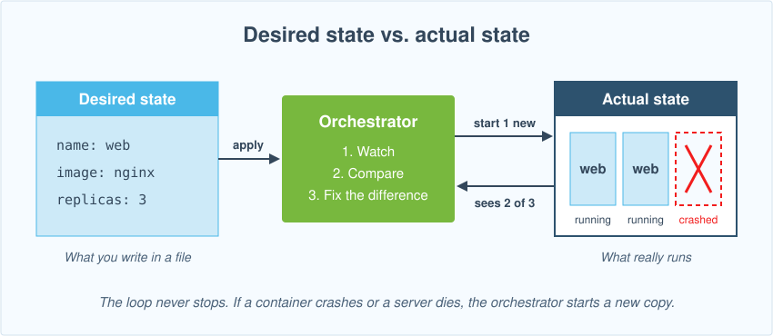
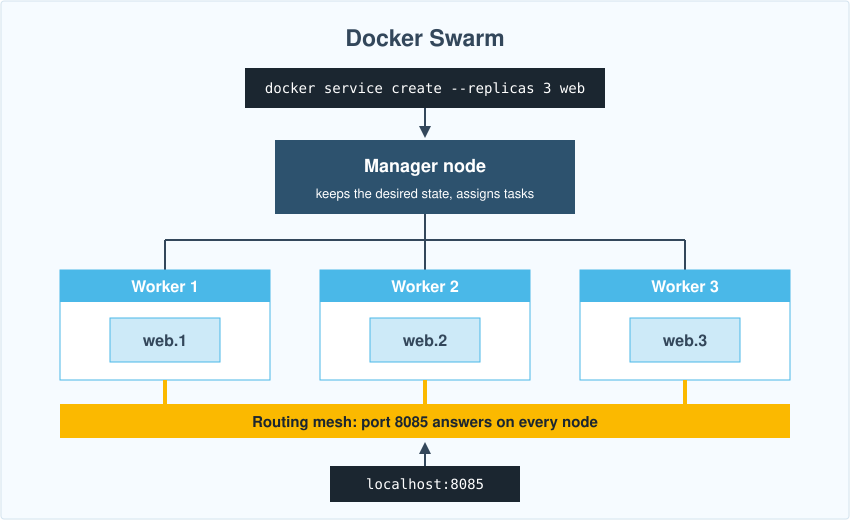
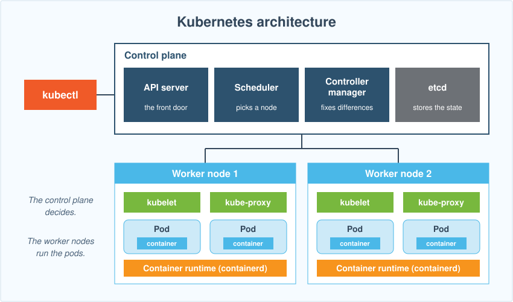
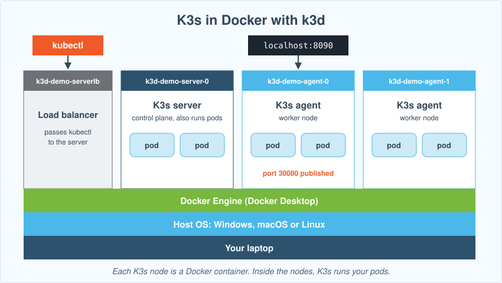
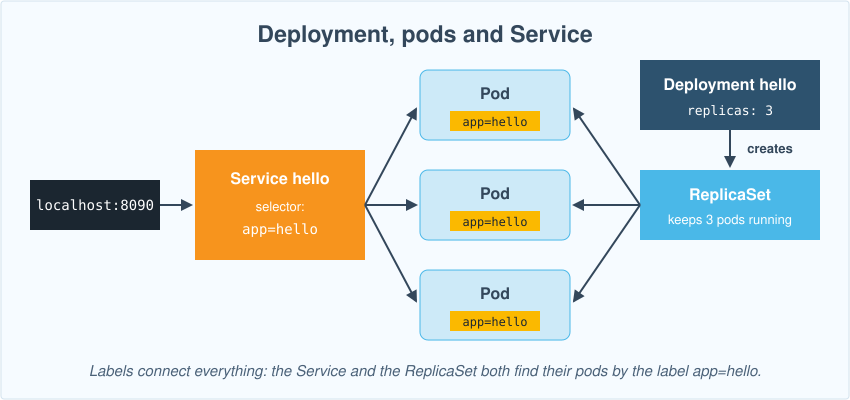
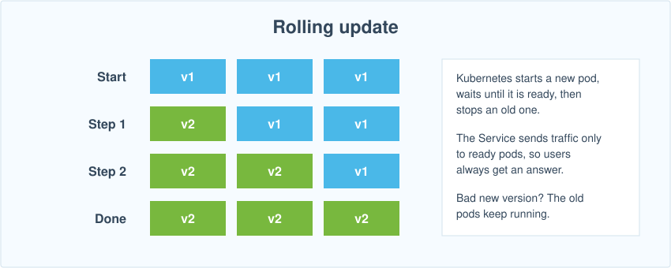

# Week 10 Lecture: Container Orchestration with Swarm and Kubernetes

Follow this guide from top to bottom. You type every command in a real terminal **on your own laptop**. You need Docker Desktop from Week 9 and two small tools, `k3d` and `kubectl`: no server, no lab machine, no cloud account. Install the tools first (see "How to install k3d and kubectl" below).

## How to follow this guide

- Every grey box is **one command** (or one file you create). Everything after the `#` is a comment that says what the command does. Copy the whole box, paste it into the terminal, press Enter, then go to the next box.
- **You should see** shows roughly what the terminal prints. IDs, times and names with random letters (like `hello-7d9f8b6c4-x2k4p`) will differ.
- Do the steps in order. Each step builds on the one before.
- Steps and subsections marked **REFERENCE** are not presented in class. The full detail stays here for you to read on your own.
- All practice work happens in one folder, `~/cluster-practice`.
- **Which box to use:** where a command differs by system, you get two boxes: **Windows (PowerShell)**, open by default, and **macOS / Linux (Terminal)**, collapsed. Click a title to open or close its box. Most `docker`, `k3d` and `kubectl` commands are identical on every system, so they get one box. The exceptions are the commands that create folders and files.

## How to install k3d and kubectl

Docker Desktop from Week 9 must be installed and running. Docker Swarm is part of Docker, so it needs nothing new. For Kubernetes you install two small tools:

- **k3d** creates a small Kubernetes cluster (K3s) inside Docker on your laptop.
- **kubectl** ("kube control") is the command line tool that talks to any Kubernetes cluster.

**Windows:** in PowerShell run these two commands, then close PowerShell and open it again so that it finds the new tools:

```powershell
winget install -e --id k3d.k3d
```

```powershell
winget install -e --id Kubernetes.kubectl
```

**macOS:** install Homebrew from <https://brew.sh> if you do not have it, then run:

```bash
brew install k3d kubectl
```

**Linux:** install k3d with its install script, and kubectl by following <https://kubernetes.io/docs/tasks/tools/install-kubectl-linux/>:

```bash
curl -s https://raw.githubusercontent.com/k3d-io/k3d/main/install.sh | bash
```

Check that both tools work:

```bash
k3d version
```

```bash
kubectl version --client
```

**You should see** a version number from each (any recent version is fine). If Windows says `The term 'k3d' is not recognized`, close PowerShell, open it again and retry.

## The big picture

In Week 9 you ran containers on one laptop with `docker run` and Compose. A real service needs more than that:

- several copies of the same container, so one crash does not take the service down
- several servers, so one dead server does not take it down either
- a new copy, started automatically, when one dies
- updates without downtime
- one address for users, whichever copy answers

Doing this by hand with `docker run` does not scale. An **orchestrator** does it for you. You tell it **what you want**, for example "three copies of nginx on port 8085", and it keeps that true.

**Desired state**

This is the most important idea of the week. You write the **desired state** in a file. The orchestrator compares it with the **actual state** and fixes the difference, again and again.



**Orchestration terminologies**

| Word | Meaning |
|---|---|
| **Cluster** | A group of machines that the orchestrator manages as one |
| **Node** | One machine in the cluster that provides computing resources: a physical server or a VM |
| **Manager / control plane** | A node that stores the desired state and makes the decisions to maintain it |
| **Worker** | A node that runs the application containers (the replicas) |
| **Replica** | An instance of an application or service running in a container. "3 replicas" means 3 identical copies. Replicas are needed for high availability, self-healing, load balancing and scalability |
| **High Availability** | If one replica fails, others can continue serving requests. |
| **Self-healing** | The orchestrator creates replacement instances when replicas fail. |
| **Load Balancing** | Incoming requests can be distributed across replicas. |
| **Scalability** | Increase replicas to handle more traffic. |
| **Rolling update** | A deployment strategy that gradually replaces old instances with new ones, instead of updating all of them at once, so the service stays up |

The figure puts the words together. One cluster has three nodes: a manager and two workers. The manager runs one service, `web`, with 3 replicas and spreads them over the workers: two on Worker node 1, one on Worker node 2. If Worker node 2 dies, the manager starts Replica 3 again on Worker node 1.


## Three orchestrators

| | Docker Swarm | Kubernetes (K8s) | K3s |
|---|---|---|---|
| What it is | The orchestrator built into Docker | The most widely used orchestrator | A small Kubernetes, packed into one program |
| Setup | Nothing: `docker swarm init` | Several parts, often rented as a cloud service (AKS, EKS, GKE) | One command on Linux (or using k3d on a laptop) |
| You describe apps with | Compose files | Kubernetes YAML files | The same YAML files as Kubernetes |
| Command line | `docker` | `kubectl` | `kubectl` |
| Good for | Small setups, teams that already know Compose | Large production systems | Small servers, edge devices, labs and tests |

You try all of them this week: Swarm first, because it builds on Week 9, then Kubernetes, which you run on your laptop as K3s.

### Docker Swarm

**Docker Swarm** (swarm mode) is the orchestrator built into Docker. One command switches it on.

- A Docker Swarm consists of manager nodes, which maintain the cluster's desired state and schedule tasks, and worker nodes, which execute those tasks by running containers.
- You describe what you want as a **service**: an image, a number of replicas and the ports.
- Task: The unit of work Swarm schedules on a node. Each task runs one container.
- A service defines the application and its desired number of replicas.
- Docker Swarm schedules each replica as a **task**, which runs a container (on an available node). Swarm decides which node runs which task.
- The **routing mesh** opens a published port on every node. A request to any node reaches one of the replicas, wherever it runs.
- Containers on different nodes talk over an **overlay network** (Week 9, Networks).
- A **stack** is a group of services described in a Compose file, the same kind of file you wrote in Week 9.



On your laptop the swarm has one node, which means it should be both manager and worker.

**Turn on swarm mode**

```bash
docker swarm init
```

**You should see** `Swarm initialized: current node (...) is now a manager`, followed by a `docker swarm join` command. Other computers would run that command to join as workers. You do not need it.

```bash
docker swarm join --token <token> <IP>:<port>
```

```bash
docker node ls
```

`docker node ls` lists the nodes of the swarm. You see one node, `Ready`, with `Leader` under `MANAGER STATUS`.

**Run a service**

```bash
docker service create --name web --replicas 3 -p 8085:80 nginx:alpine
```

| Part | Meaning |
|---|---|
| `--name web` | The name of the service |
| `--replicas 3` | The desired state: 3 copies |
| `-p 8085:80` | Publish port 8085 on every node (the routing mesh) to port 80 in the containers |
| `nginx:alpine` | The image, as in Week 9 |

**You should see** the progress of each of the 3 tasks, then a line that says the service `converged`: the actual state now matches the desired state.

```bash
docker service ls
```

```bash
docker service ps web
```

`docker service ls` lists the services: `web` shows `3/3` under `REPLICAS`. `docker service ps web` lists its tasks, `web.1`, `web.2` and `web.3`, each `Running`. Open <http://localhost:8085> in your browser. **You should see** `Welcome to nginx!`.

**Self-healing**

Every task is a normal container. List them:

```bash
docker ps
```

Delete one of them by force, as if it crashed. Replace `NAME` with a name from the `NAMES` column, for example `web.2.k3j5x...`:

```bash
docker rm -f NAME
```

```bash
docker service ps web
```

**You should see** three `Running` tasks again. One of them is new (look at `CURRENT STATE`), and below it, marked `\_`, is the old task that Swarm replaced. Swarm saw 2 of 3 and started a new copy: nobody typed `docker run`. If you see only two, wait a few seconds and run the command again.

**Scale**

```bash
docker service scale web=5
```

```bash
docker service ps web
```

**You should see** five tasks. Scaling down works the same way, for example `docker service scale web=2`. Delete the service:

```bash
docker service rm web
```

**Stacks: a Compose file on a swarm**

A stack runs a Compose file on a swarm. The new part is `deploy:`, which holds the swarm settings, here the number of replicas. Create a folder and a Compose file:

<details>
<summary>macOS / Linux (Terminal)</summary>

```bash
mkdir -p ~/cluster-practice/stack && cd ~/cluster-practice/stack
```

</details>

<details open>
<summary>Windows (PowerShell)</summary>

```powershell
New-Item -ItemType Directory -Force ~/cluster-practice/stack | Out-Null
Set-Location ~/cluster-practice/stack
```

</details>

<details>
<summary>macOS / Linux (Terminal)</summary>

```bash
cat > compose.yaml <<'EOF'
services:
  web:
    image: nginx:alpine
    ports:
      - "8086:80"
    deploy:
      replicas: 3
EOF
```

</details>

<details open>
<summary>Windows (PowerShell)</summary>

```powershell
@'
services:
  web:
    image: nginx:alpine
    ports:
      - "8086:80"
    deploy:
      replicas: 3
'@ | Set-Content compose.yaml -Encoding ascii
```

</details>

```bash
docker stack deploy -c compose.yaml demo  # Run the Compose file as a stack named demo.
```

```bash
docker stack services demo
```

**You should see** one service, `demo_web`, with `3/3` under `REPLICAS`. Swarm puts the stack name in front of each service name. Open <http://localhost:8086>: the nginx page again.

**Try it yourself**

Open `compose.yaml` in an editor (for example `notepad compose.yaml` on Windows or `nano compose.yaml` on macOS and Linux), change `replicas: 3` to `replicas: 5`, save, and run the same `docker stack deploy` command again. What happens?

<details>
<summary>Answer</summary>

`docker stack services demo` shows `5/5`. The same command creates a stack or updates it: Swarm compares the file (the desired state) with what runs (the actual state) and starts two more copies.

</details>

Delete the stack:

```bash
docker stack rm demo
```

**Leave swarm mode**

```bash
docker swarm leave --force  # Turn swarm mode off. --force is needed because this node is the last manager.
```

| Command | What it does |
|---|---|
| `docker swarm init` | Turn on swarm mode. This node becomes a manager. |
| `docker node ls` | List the nodes |
| `docker service create --name NAME --replicas 3 -p 8085:80 IMAGE` | Start a service with 3 replicas |
| `docker service ls` | List the services |
| `docker service ps NAME` | List the tasks of a service and where they run |
| `docker service scale NAME=5` | Change the number of replicas |
| `docker service update --image IMAGE NAME` | Roll out a new image, one task at a time |
| `docker service rm NAME` | Delete a service |
| `docker stack deploy -c FILE NAME` | Create or update a stack from a Compose file |
| `docker stack services NAME` | List the services of a stack |
| `docker stack rm NAME` | Delete a stack |
| `docker swarm leave --force` | Turn off swarm mode on this node |

## Kubernetes

**Kubernetes** (often written **K8s**: K, then 8 letters, then s) is the most widely used orchestrator. Google started it and made it open source in 2014. Today the Cloud Native Computing Foundation (CNCF) looks after it, and every large cloud offers it as a service: AKS on Azure, EKS on AWS and GKE on Google Cloud. It does what Swarm does and much more, so it has more parts.

A Kubernetes cluster has two halves:

- The **control plane** decides. It stores the desired state and works out what has to change.
- The **worker nodes** run the containers, inside **pods**.

You never talk to the nodes directly. You send every request to the **API server**, with `kubectl`.



| Part | Where | Job |
|---|---|---|
| **API server** | Control plane | The front door. `kubectl` and all the other parts talk to it. |
| **etcd** | Control plane | The database that stores the desired state |
| **Scheduler** | Control plane | Picks a node for each new pod |
| **Controller manager** | Control plane | Runs the loops that compare desired and actual state and fix the difference |
| **kubelet** | Every node | Starts the pods on its node and reports how they are doing |
| **kube-proxy** | Every node | Sends the traffic for a Service to the right pods |
| **Container runtime** | Every node | Runs the containers (containerd, the same runtime Docker uses inside) |

**Kubernetes terminologies**

| Word | Meaning |
|---|---|
| **Pod** | The smallest unit Kubernetes runs: one container (sometimes a few that work together) with its own IP address |
| **Deployment** | "Keep N identical pods running, and update them safely" |
| **ReplicaSet** | What a Deployment creates to keep the count right. You rarely touch it. |
| **Service** | One stable name and address in front of a changing group of pods |
| **Label** | A `key=value` tag on an object, such as `app=hello` |
| **Selector** | A rule that picks objects by label, such as "all pods with `app=hello`" |
| **Manifest** | A YAML file that describes an object: the desired state |
| **Namespace** | A folder inside the cluster that keeps projects apart |

## K3s: a lightweight Kubernetes

**K3s** is a full Kubernetes in one small program. Rancher (now part of SUSE) created it, and it is a CNCF project. The name is a joke on K8s: half the size, so "K3s".

- **The same Kubernetes:** K3s passes the official Kubernetes tests, so you use the same `kubectl` commands and the same YAML files. What you learn on K3s works on AKS, EKS or GKE.
- **Small:** one file of well under 100 MB holds the control plane, the kubelet and containerd. It runs on a Raspberry Pi.
- **Ready to use:** networking, DNS, a load balancer and storage are already set up.
- **Server and agent:** a K3s **server** runs the control plane (and can run pods too). A K3s **agent** is a worker node.

People use K3s for small servers, for computers in shops and factories (edge computing), for IoT devices, and for test clusters and labs like this one.

K3s itself runs on Linux. On a laptop, **k3d** ("K3s in Docker") runs each K3s node as a Docker container, so a whole cluster starts in seconds and is deleted with one command.



## Create a K3s cluster with k3d

```bash
k3d cluster create demo --agents 2 -p "8090:30080@agent:0"
```

| Part | Meaning |
|---|---|
| `demo` | The name of the cluster |
| `--agents 2` | Two agent (worker) nodes next to the server node: 3 nodes in total |
| `-p "8090:30080@agent:0"` | Publish port 8090 of your laptop to port 30080 of the first agent. You use it in "Services" below. |

The first run downloads the K3s image and takes a minute. **You should see** a list of `INFO` lines with `Cluster 'demo' created successfully!` near the end. k3d also points `kubectl` at the new cluster.

```bash
kubectl get nodes
```

**You should see** three nodes, `k3d-demo-server-0`, `k3d-demo-agent-0` and `k3d-demo-agent-1`, all `Ready`. If one says `NotReady`, wait 20 seconds and run the command again.

```bash
docker ps
```

Each node is a container on your laptop. One more container, `k3d-demo-serverlb`, is a small load balancer in front of the server.

```bash
kubectl cluster-info
```

`kubectl cluster-info` shows the address of the control plane (the API server) that `kubectl` talks to.

## Pods

A **pod** is the smallest thing Kubernetes runs. Start one the quick way, as you did with `docker run`:

```bash
kubectl run hello --image=nginx:alpine
```

```bash
kubectl get pods
```

The status goes from `ContainerCreating` to `Running`. Run `kubectl get pods` again until it says `Running`.

```bash
kubectl get pods -o wide
```

`-o wide` adds columns: the pod's own IP address and the `NODE` it runs on. The scheduler picked that node.

```bash
kubectl describe pod hello
```

`kubectl describe` shows everything about the pod. Read the **Events** list at the bottom: it shows what happened (scheduled, image pulled, started) and, when something fails, why. Always look there first.

```bash
kubectl logs hello
```

```bash
kubectl exec hello -- hostname
```

`kubectl exec` runs a command inside the pod: everything after `--` is the command. **You should see** `hello`, the name of the pod. Now delete the pod:

```bash
kubectl delete pod hello
```

```bash
kubectl get pods
```

**You should see** `No resources found`. Nobody brings it back: a pod you create by hand is not supervised. For that you use a Deployment.

| Kubernetes | Docker (Week 9) | What it does |
|---|---|---|
| `kubectl run NAME --image=IMAGE` | `docker run` | Start a pod |
| `kubectl get pods` | `docker ps` | List the pods |
| `kubectl describe pod NAME` | `docker inspect` | Show the details and the Events |
| `kubectl logs NAME` | `docker logs` | Show the output |
| `kubectl exec NAME -- COMMAND` | `docker exec` | Run a command inside |
| `kubectl delete pod NAME` | `docker rm -f` | Delete it |

## Deployments: keep N copies alive

From now on you write the desired state in **manifests**: YAML files that describe an object. Every manifest has four top-level keys: `apiVersion`, `kind`, `metadata` and `spec`. Create a folder for them:

<details>
<summary>macOS / Linux (Terminal)</summary>

```bash
mkdir -p ~/cluster-practice/k8s && cd ~/cluster-practice/k8s
```

</details>

<details open>
<summary>Windows (PowerShell)</summary>

```powershell
New-Item -ItemType Directory -Force ~/cluster-practice/k8s | Out-Null
Set-Location ~/cluster-practice/k8s
```

</details>

<details>
<summary>macOS / Linux (Terminal)</summary>

```bash
cat > deploy.yaml <<'EOF'
apiVersion: apps/v1
kind: Deployment
metadata:
  name: hello
spec:
  replicas: 3
  selector:
    matchLabels:
      app: hello
  template:
    metadata:
      labels:
        app: hello
    spec:
      containers:
        - name: web
          image: nginx:alpine
          ports:
            - containerPort: 80
EOF
```

</details>

<details open>
<summary>Windows (PowerShell)</summary>

```powershell
@'
apiVersion: apps/v1
kind: Deployment
metadata:
  name: hello
spec:
  replicas: 3
  selector:
    matchLabels:
      app: hello
  template:
    metadata:
      labels:
        app: hello
    spec:
      containers:
        - name: web
          image: nginx:alpine
          ports:
            - containerPort: 80
'@ | Set-Content deploy.yaml -Encoding ascii
```

</details>

Read it from the top:

| Lines | Meaning |
|---|---|
| `kind: Deployment`, `name: hello` | A Deployment named `hello` |
| `replicas: 3` | The desired state: 3 pods |
| `selector`, `matchLabels` | Which pods belong to this Deployment: the ones with the label `app: hello` |
| `template` | The pod to create. Its label `app: hello` matches the selector. |
| `containers` | The container inside each pod: named `web`, image `nginx:alpine`, port 80 |

YAML uses **spaces** for indentation (never tabs), as in Week 9.

**Labels connect everything.** The Deployment finds its pods by the label `app: hello`, and so does the Service you create next. If the labels do not match, nothing is connected. Most Kubernetes mistakes are label mistakes.



```bash
kubectl apply -f deploy.yaml  # Create (or update) what the file describes. apply is the command you use all week.
```

```bash
kubectl get deployments
```

```bash
kubectl get pods -o wide
```

**You should see** `hello` with `3/3` under `READY`, and three pods named `hello-...`. Look at the `NODE` column: the scheduler spread the pods over your nodes.

**Self-healing.** Delete one pod. Replace `POD_NAME` with a name from `kubectl get pods`:

```bash
kubectl delete pod POD_NAME
```

```bash
kubectl get pods
```

**You should see** three pods again. One is new (look at its `AGE`). The Deployment saw 2 of 3 and started a new one.

**Scale.**

```bash
kubectl scale deployment hello --replicas=5
```

```bash
kubectl get pods
```

**You should see** five pods.

**Try it yourself**

Run `kubectl apply -f deploy.yaml` again. How many pods do you have now, and why?

<details>
<summary>Answer</summary>

Three. The file says `replicas: 3`, and `apply` makes the cluster match the file again. In real projects you change the file (and commit it to Git) instead of typing `kubectl scale`, so that the file always describes what runs.

</details>

| Command | What it does |
|---|---|
| `kubectl apply -f FILE` | Create or update what the file describes |
| `kubectl get deployments` | List the Deployments and how many of their pods are ready |
| `kubectl scale deployment NAME --replicas=N` | Change the number of pods |
| `kubectl delete -f FILE` | Delete what the file describes |

## Services: one stable address

Pods come and go, and every new pod gets a new IP address. A **Service** gives a group of pods one stable name and address, and spreads the requests over them. Like the Deployment, it finds its pods by label.

| Service type | Reachable from |
|---|---|
| `ClusterIP` (the default) | Only inside the cluster. Other pods reach it by its name, like containers on a Docker network in Week 9. |
| `NodePort` | A port (30000 to 32767) that opens on every node |
| `LoadBalancer` | A public address from the cloud provider (AKS, EKS, GKE) |

You use a `NodePort`, because you published port 30080 of a node to port 8090 of your laptop when you created the cluster.

<details>
<summary>macOS / Linux (Terminal)</summary>

```bash
cat > service.yaml <<'EOF'
apiVersion: v1
kind: Service
metadata:
  name: hello
spec:
  type: NodePort
  selector:
    app: hello
  ports:
    - port: 80
      targetPort: 80
      nodePort: 30080
EOF
```

</details>

<details open>
<summary>Windows (PowerShell)</summary>

```powershell
@'
apiVersion: v1
kind: Service
metadata:
  name: hello
spec:
  type: NodePort
  selector:
    app: hello
  ports:
    - port: 80
      targetPort: 80
      nodePort: 30080
'@ | Set-Content service.yaml -Encoding ascii
```

</details>

| Line | Meaning |
|---|---|
| `type: NodePort` | Open a port on every node |
| `selector`, `app: hello` | Send the traffic to the pods with this label |
| `port: 80` | The port of the Service inside the cluster |
| `targetPort: 80` | The port of the container |
| `nodePort: 30080` | The port that opens on every node |

```bash
kubectl apply -f service.yaml
```

```bash
kubectl get services
```

**You should see** `hello` of type `NodePort` with `80:30080/TCP`. The other Service, `kubernetes`, is the API server itself.

```bash
kubectl describe service hello
```

Look at `Selector` and `Endpoints`. **Endpoints** lists one address per pod behind the Service. If it is empty, the selector does not match the pod labels.

Open <http://localhost:8090> in your browser. **You should see** `Welcome to nginx!`. The request went from port 8090 of your laptop to port 30080 of `k3d-demo-agent-0`, then to the Service, then to one of the pods, on whichever node it runs.

**Try it yourself**

Open `service.yaml` in an editor, change the selector from `app: hello` to `app: wrong`, save, and apply it again. What do `kubectl describe service hello` and the browser show? Then put `app: hello` back and apply again.

<details>
<summary>Answer</summary>

`Endpoints` is empty (`<none>`) and the page no longer loads: the Service looks for pods with the label `app=wrong` and finds none. The pods still run; only the connection is gone. When you put `app: hello` back and apply, the page works again.

</details>

| Command | What it does |
|---|---|
| `kubectl get services` | List the Services, their type and their ports |
| `kubectl describe service NAME` | Show the selector and the endpoints (the pods behind it) |

## Rolling updates and rollbacks

Change the image of a Deployment, and Kubernetes replaces the pods **gradually**: it starts a new pod, waits until it is ready, then stops an old one. The service never goes down.



```bash
kubectl set image deployment/hello web=nginx:1.27-alpine  # Change the image of the container named web.
```

```bash
kubectl rollout status deployment/hello
```

`rollout status` follows the update and ends with `successfully rolled out`.

```bash
kubectl rollout history deployment/hello
```

`rollout history` lists the revisions: every change to the pod template is one revision.

Now break it on purpose, with an image tag that does not exist:

```bash
kubectl set image deployment/hello web=nginx:does-not-exist
```

```bash
kubectl get pods
```

**You should see** one or two new pods with `ErrImagePull` or `ImagePullBackOff`, and the old pods still `Running`. Kubernetes waits for new pods to be ready before it stops the old ones, so users see no outage. Go back to the last working revision:

```bash
kubectl rollout undo deployment/hello
```

```bash
kubectl rollout status deployment/hello
```

| Command | What it does |
|---|---|
| `kubectl set image deployment/NAME CONTAINER=IMAGE` | Change the image (this starts a rolling update) |
| `kubectl rollout status deployment/NAME` | Follow an update until it finishes |
| `kubectl rollout history deployment/NAME` | List the revisions |
| `kubectl rollout undo deployment/NAME` | Go back to the previous revision |

## Run your own image

A cluster cannot see the images on your laptop: each node has its own image store. Real clusters download images from a registry such as Docker Hub. With k3d you can also copy a local image into every node. Use the `site:1.0` image from the Week 9 lecture ("Build your own image with a Dockerfile"):

```bash
docker images site
```

If `site:1.0` is not in the list, build it again as in Week 9. Then copy it into the cluster:

```bash
k3d image import site:1.0 -c demo  # Copy the image site:1.0 from your laptop into every node of the cluster demo.
```

```bash
kubectl set image deployment/hello web=site:1.0
```

```bash
kubectl rollout status deployment/hello
```

Refresh <http://localhost:8090>. **You should see** your own page: "Bytown NetOps". Your Week 9 image now runs as several pods on a Kubernetes cluster.

| Command | What it does |
|---|---|
| `k3d image import IMAGE -c CLUSTER` | Copy a local image into every node of a k3d cluster |

## More Kubernetes objects

> **REFERENCE** Not presented in class. Read it on your own.

| Object | What it is for |
|---|---|
| **Namespace** | A folder inside the cluster. `kubectl get pods -n NAME` lists the pods of one namespace. Your objects so far are in `default`. |
| **ConfigMap** | Settings kept outside the image and given to the pods as environment variables or files |
| **Secret** | Like a ConfigMap, for passwords and keys. The value is only base64 encoded, not encrypted. |
| **Ingress** | Sends web traffic to Services by host name or path. K3s includes one, Traefik. |
| **PersistentVolumeClaim** | Storage that survives when a pod is replaced, like a Docker volume |
| **StatefulSet** | Like a Deployment, for databases: each pod keeps its name and its storage |
| **DaemonSet** | Exactly one pod on every node, for example a log collector |
| **Job** and **CronJob** | A pod that runs to the end once, or on a schedule |

Try `kubectl get pods -n kube-system`: these are the pods that K3s runs for itself (DNS, Traefik, the load balancer and more).

## Clusters with several machines

> **REFERENCE** Not presented in class. It needs several Linux machines (or VMs), so you only read this part.

**Docker Swarm.** On the first machine:

```bash
docker swarm init --advertise-addr MANAGER_IP
```

It prints a `docker swarm join --token ... MANAGER_IP:2377` command. Run that command on every other machine, and each one joins as a worker. `docker swarm join-token worker` prints the command again later. `docker node ls` on the manager lists all the nodes.

**K3s.** On the first machine, install a K3s server with one command:

```bash
curl -sfL https://get.k3s.io | sh -
```

```bash
sudo k3s kubectl get nodes
```

Read the join token on the server:

```bash
sudo cat /var/lib/rancher/k3s/server/node-token
```

On every other machine, install a K3s agent that joins the server. Replace `SERVER_IP` and `TOKEN`:

```bash
curl -sfL https://get.k3s.io | K3S_URL=https://SERVER_IP:6443 K3S_TOKEN=TOKEN sh -
```

`sudo k3s kubectl get nodes` on the server now lists all the nodes. The manifests and `kubectl` commands from this lecture work unchanged on this cluster.

## Clean up

> **REFERENCE** Read it on your own; the lab practises it.

```bash
kubectl delete -f deploy.yaml -f service.yaml  # Delete the Deployment, its pods and the Service.
```

```bash
k3d cluster list  # List your k3d clusters.
```

```bash
k3d cluster stop demo  # Stop the cluster and free the memory. k3d cluster start demo brings it back.
```

```bash
k3d cluster delete demo  # Delete the cluster and everything in it.
```

## If something goes wrong

| Message or symptom | Cause and fix |
|---|---|
| `Cannot connect to the Docker daemon` or `error during connect` | Docker Desktop is not running. Start it and wait until it says it is running. |
| `The term 'k3d' is not recognized` or `k3d: command not found` (same for `kubectl`) | The tool is not installed, or the terminal was open during the install. Close and reopen the terminal. If it still fails, install it again (see "How to install k3d and kubectl"). |
| `could not choose an IP address to advertise` (from `docker swarm init`) | Your computer has several network addresses. For a one-node swarm, run `docker swarm init --advertise-addr 127.0.0.1`. |
| `This node is not a swarm manager` | Swarm mode is off. Run `docker swarm init`. |
| `This node is already part of a swarm` | Swarm mode is already on. Go on, or run `docker swarm leave --force` to start over. |
| `port is already allocated` | Another container, service or cluster uses that port. `docker ps` and `docker service ls` show what runs. |
| `The connection to the server ... was refused` | The cluster is stopped or deleted. Run `k3d cluster list`, then `k3d cluster start demo`. |
| A pod stays `Pending` | No node has room for it. Run `kubectl describe pod NAME` and read the Events. Close other programs, or give Docker Desktop more memory (Settings > Resources). |
| `ErrImagePull` or `ImagePullBackOff` | The image name or tag is wrong, or it is a local image that you did not copy with `k3d image import`. |
| `CrashLoopBackOff` | The container starts and exits again and again. `kubectl logs NAME` shows why. |
| The page does not load and `Endpoints` is empty | The Service selector does not match the pod labels. Compare them. |
| `error parsing ... yaml: line N` | A tab or a wrong indent in the YAML file. Use spaces. |
| Nothing at `http://localhost:8090` | Check that `kubectl get services` shows `80:30080/TCP`. If you created the cluster without `-p`, delete it and create it again. |
| The cluster does not answer after the laptop slept | Run `k3d cluster stop demo`, then `k3d cluster start demo`. |
