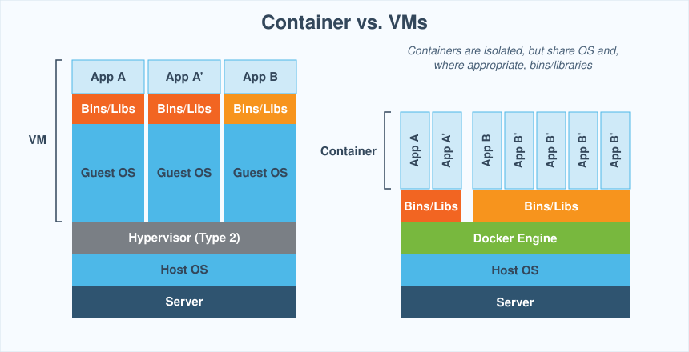
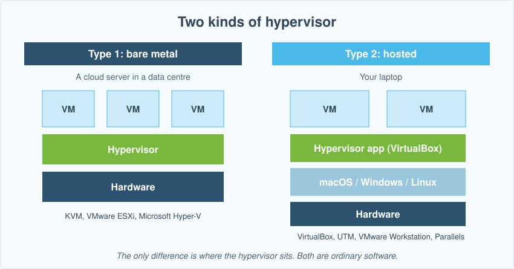
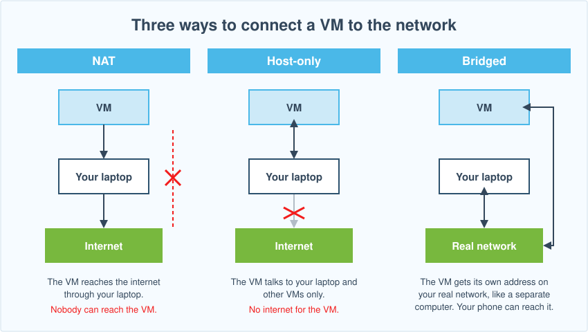
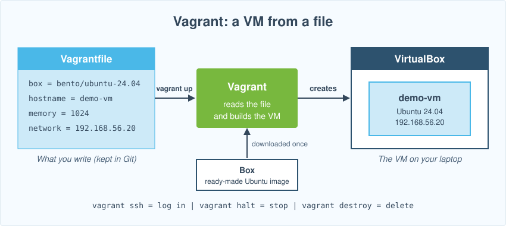
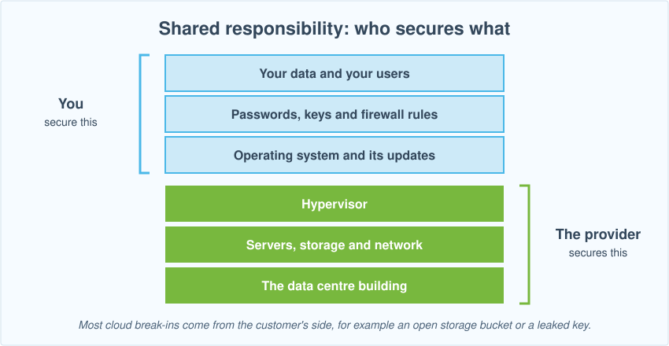
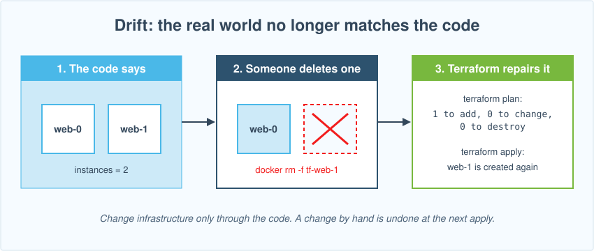

# Week 11 Lecture: Virtualization, Cloud and Infrastructure as Code
**NET2008 DevOps · Algonquin College**

Follow this guide from top to bottom. You type every command in a real terminal **on your own laptop** (Terminal on macOS, your Linux terminal, the **Ubuntu (WSL 2) app** on Windows). You need Docker running and **Terraform** installed (see [W11_Setup_Terraform.md](W11_Setup_Terraform.md)). Two parts need extra tools and are optional for some laptops: the VM by hand (VirtualBox or UTM) and the Azure cloud example (a free student account). The guide tells you what to do if you cannot run them.

## How to follow this guide

- Every grey box is **one command** (or one file you create). Everything after the `#` on the first line is a comment that says what the command does. Copy the whole box, paste it into the terminal, press Enter, then go to the next box.
- Some boxes come in two versions, **macOS / Linux** and **Windows**. Open the one for your system. The Windows one is open by default.
- Do the sections in order. Terraform practice work happens in one folder, `~/iac-practice`.

## The big picture

This is a short introduction. Nothing here needs to be memorized: it explains why we spend a whole class on this.

In Week 9 you ran programs in containers. In Week 10 you ran many containers on a cluster. Both assumed one thing: **a computer to run them on**. This week asks where those computers come from, and how to create them quickly and the same way every time.

There are three problems. Each section of today's class solves one.

| Problem | The idea that solves it | What we use today |
|---|---|---|
| "I need a separate Linux system, but I have one laptop." | **Virtualization**: one physical computer runs several virtual computers (VMs). | VirtualBox or UTM, then Vagrant |
| "I do not want to buy and look after servers. I need 1 today and 100 tomorrow." | **Cloud**: rent computers from a provider and pay by the hour. | Azure |
| "Creating machines by clicking is slow, and nobody can repeat it exactly." | **Infrastructure as Code (IaC)**: write the machines you want in a file, and a tool builds them. | Terraform |


Ansible, the tool that sets up the **inside** of a server, is next week (Week 12). Today we only create the servers.

**Rough plan for the class:** virtualization about 45 minutes (VM by hand, then Vagrant), cloud about 25 minutes, Terraform about 50 minutes. These times are estimates.

## Virtualization

### What is virtualization?

**Virtualization** means software splits one physical computer into several **virtual machines (VMs)**. Each VM behaves like a complete separate computer: it has its own operating system, its own disk, its own memory and its own network card. The program that creates and runs VMs is called a **hypervisor**.

**Example:** your laptop runs macOS or Windows. With a hypervisor you start Ubuntu Linux in a window, log in, install software, break it, and delete it. Your real system is not touched.

### How is a VM different from a container?

Containers solve a similar problem in a different way.

| | Virtual machine | Container |
|---|---|---|
| What it is | A whole computer in software | A packaged program in an isolated process |
| Operating system | Its **own** kernel and OS | **Shares** the kernel of the host |
| Size | Gigabytes | Megabytes |
| Starts in | Seconds to minutes | Under a second |
| Isolation | Strong: separate system | Good, but weaker |
| Can run a different OS than the host? | Yes (Linux VM on a Mac) | No: it uses the host's kernel |
| Use it when | You need a full separate system | You need to run an application the same way everywhere |



VMs and containers are often used together. In the cloud, your containers usually run **inside** VMs.

### Two kinds of hypervisor

The only difference is **where the hypervisor sits**. Both are ordinary software.

| | Type 1 ("bare metal") | Type 2 ("hosted") |
|---|---|---|
| Runs on | Directly on the hardware, with no normal OS underneath | A normal operating system (macOS, Windows, Linux) |
| Where you meet it | Data centres (cloud providers) | Your laptop |
| Examples | KVM, VMware ESXi, Microsoft Hyper-V | VirtualBox, UTM, VMware Workstation, Parallels |



The cloud uses type 1. Today you use a type 2 hypervisor on your laptop.

### VM networking

A VM has a virtual network card. You choose how it connects:

| Mode | What the VM can reach | Who can reach the VM | Use it for |
|---|---|---|---|
| **NAT** | The internet, through your laptop | Nobody (unless you forward a port) | Downloading updates. This is the default. |
| **Host-only** (private network) | Your laptop and other VMs only | Your laptop | A private lab with a fixed address |
| **Bridged** | The real network, like a separate computer | Anyone on that network | A VM that your phone or a classmate must reach |



### Hands-on: build a VM by hand

**Goal:** create an Ubuntu Server VM manually, so you feel what Vagrant will remove later. It takes about 25 minutes, and most of that is the Ubuntu installer.

#### Find your tag

The processor of your laptop decides which tool you use. Find your row and remember your **tag** (A, B or C). Every step below tells you what each tag does.

| Tag | Your computer | Tool you use | Ubuntu ISO you need |
|---|---|---|---|
| **A** | Windows with an Intel or AMD chip, Mac with an Intel chip, Linux on Intel or AMD | **VirtualBox** | amd64 |
| **B** | Mac with Apple silicon (M1, M2, M3, M4) | **UTM** | arm64 |
| **C** | Windows with an ARM chip (for example Snapdragon), **Windows 11 Pro or Enterprise** | **Hyper-V** (built into Windows) | arm64 |

How to check your chip: on a Mac open the Apple menu > **About This Mac** and read **Chip**. On Windows open **Settings > System > About** and read **System type**. On Linux run `uname -m`: `x86_64` means Intel or AMD, `aarch64` or `arm64` means ARM.

**Why different tools?** A VM must match the processor of the host. An ARM laptop can only run ARM systems, so it needs the **arm64** Ubuntu ISO. VirtualBox on an Apple silicon Mac does run Ubuntu for ARM (Vagrant uses it below), but installing from an ISO there is not an officially supported route, so for the VM by hand those Macs use UTM, which is built for Apple silicon. Windows on ARM uses Hyper-V.

#### 1. Download the Ubuntu Server ISO

An **ISO** is a disk image of the Ubuntu installer, like a virtual DVD. Save it in your Downloads folder. It is about 2 GB, so start it now.

- **Tag A:** download the **amd64** Ubuntu Server (LTS) from <https://ubuntu.com/download/server>.
- **Tag B and Tag C:** download the **arm64** Ubuntu Server (LTS) from <https://ubuntu.com/download/server/arm>.

#### 2. Install the hypervisor

**Tag A (VirtualBox):** use the commands for your system.

<details>
<summary>macOS / Linux (Terminal)</summary>

Mac with an Intel chip:

```bash
brew install --cask virtualbox  # Install VirtualBox. macOS asks you to allow its system extension in System Settings > Privacy & Security. Allow it and restart.
```

Linux on Intel or AMD (Ubuntu or Debian):

```bash
sudo apt update && sudo apt install -y virtualbox  # Install VirtualBox.
```

</details>

<details open>
<summary>Windows (PowerShell)</summary>

Open **PowerShell as Administrator** (right-click the Start button, choose Terminal (Admin)):

```powershell
winget install --id Oracle.VirtualBox -e  # Install VirtualBox.
```

VirtualBox can conflict with WSL 2 and Docker Desktop on some Windows laptops. If Docker stops working after you install it, uninstall VirtualBox and read the rest of this section without doing the hands-on.

</details>

**Tag B (UTM):**

```bash
brew install --cask utm  # Install UTM.
```

**Tag C (Hyper-V):** open **PowerShell as Administrator**:

```powershell
Enable-WindowsOptionalFeature -Online -FeatureName Microsoft-Hyper-V -All  # Turn on Hyper-V, Windows' built-in hypervisor. Restart when it asks.
```

#### 3. Create the VM and install Ubuntu

The names of buttons can change a little between versions. Follow the idea if a label looks different.

**Tag A (VirtualBox):**

1. Open **VirtualBox** and click **New**.
2. **Name:** `manual-vm`. **ISO Image:** choose the Ubuntu Server ISO you downloaded. Click **Next**.
3. If VirtualBox shows **Unattended Install**, you can type a user name and password there and it installs Ubuntu for you. Otherwise you answer the Ubuntu installer questions yourself.
4. **Hardware:** Base Memory **2048 MB**, Processors **2**. Click **Next**.
5. **Virtual Hard disk:** **20 GB**. Click **Next**, then **Finish**.
6. Select `manual-vm` and click **Start**. A window opens with the Ubuntu installer.

**Tag B (UTM):**

1. Open **UTM** and click **Create a New Virtual Machine**.
2. Choose **Virtualize**, then **Linux**.
3. **Boot ISO Image:** click **Browse** and choose the arm64 Ubuntu Server ISO.
4. **Memory:** 2048 MB, **CPU Cores:** 2. **Storage:** 20 GB. Skip the shared directory. Name it `manual-vm` and click **Save**.
5. Click the **Play** button to start the VM.

**Tag C (Hyper-V):** do not use **Quick Create**: it does not work for Linux on ARM.

1. Open **Hyper-V Manager** from the Start menu. Right-click your computer's name on the left, choose **New > Virtual Machine**, and click **Next**.
2. **Name:** `manual-vm`. Click **Next**.
3. **Generation:** choose **Generation 2**. Click **Next**.
4. **Startup memory:** `2048` MB. Click **Next**.
5. **Networking:** choose **Default Switch** (this is NAT). Click **Next**.
6. **Virtual hard disk:** `20` GB. Click **Next**.
7. **Installation options:** choose **Install an operating system from a bootable image file**, browse to the **arm64** Ubuntu Server ISO, and click **Finish**.
8. **Before you start it**, right-click `manual-vm` and open **Settings**. Under **Security**, **untick Enable Secure Boot**, and click **OK**. Ubuntu on ARM does not start with Secure Boot on. Under **Processor**, set **Number of virtual processors** to `1`: some ARM laptops freeze with more.
9. Double-click `manual-vm`, click **Start**, and the Ubuntu installer appears.

**All tags: the Ubuntu installer.** Use the keyboard. Press Enter on the defaults for language, keyboard and network. When it asks for a profile, set your name, a server name (`manual-vm`), a user name and a password, and tick **Install OpenSSH server** when offered. Skip optional snaps. Wait for the installation to finish and choose **Reboot Now**.

- **Tag B only:** if the installer starts again after the reboot, shut the VM down, open its settings and clear the CD/DVD drive (**Eject**), then start it again.

When you see `manual-vm login:`, type your user name and password.

#### 4. Look inside your VM

**All tags except D.** Run these inside the VM. It is a separate computer with its own system.

```bash
hostname  # The name you chose.
```

```bash
cat /etc/os-release | head -2  # The operating system: Ubuntu Server.
```

```bash
free -h | head -2  # The memory you gave it: about 2 GB.
```

```bash
ip -br address  # The VM's network address. With NAT it is a private address: usually 10.0.2.15 for Tag A, and a 192.168.x.x address for Tag B.
```

```bash
ping -c 2 8.8.8.8  # NAT lets the VM reach the internet.
```

#### 5. Change the network mode

Shut the VM down with `sudo poweroff`. Then change how the network card connects:

- **Tag A (VirtualBox):** select the VM, **Settings > Network > Adapter 1 > Attached to: Bridged Adapter**, choose your Wi-Fi or Ethernet card, click **OK**, and start the VM again.
- **Tag B (UTM):** open the VM's settings, **Network > Network Mode: Bridged (Advanced)**, choose the interface, save, and start it again.
- **Tag C (Hyper-V):** in Hyper-V Manager open **Virtual Switch Manager**, create a new **External** virtual switch on your Wi-Fi or Ethernet card, then in the VM's **Settings > Network Adapter** choose that switch, and start the VM again.

Log in and run `ip -br address`. The VM now has an address on your **real network**, like a separate computer. Run `ping -c 2` followed by that address from your laptop terminal: it answers. With NAT it would not.

#### 6. Delete the VM

Shut the VM down with `sudo poweroff`. Then:

- **Tag A (VirtualBox):** right-click the VM and choose **Remove > Delete all files**.
- **Tag B (UTM):** right-click the VM and choose **Delete**.
- **Tag C (Hyper-V):** right-click the VM and choose **Delete**, then delete its `.vhdx` disk file from the folder shown in the VM's settings.

**What did that cost?** About 25 minutes and a dozen clicks. If your teammate needs the same VM, you must repeat the clicks and hope you choose the same options. If you need ten VMs, it takes four hours. This is the problem Vagrant solves.

### Vagrant: the same VM from a file

**Vagrant** is a tool that drives VirtualBox for you. You describe the VM in a small text file called a `Vagrantfile`. One command, `vagrant up`, builds the VM. It skips the installer because it starts from a ready-made image called a **box**.



| | By hand (what you just did) | Vagrant |
|---|---|---|
| Time | About 25 minutes | A few minutes, mostly the first download |
| Your work | About a dozen clicks | One command |
| Repeatable | No | Yes: the same file gives the same VM |
| Teammates | Each repeats the clicks | Each runs the same file from Git |
| Delete and rebuild | Hours | `vagrant destroy` then `vagrant up` |

#### Who can run Vagrant?

Vagrant needs two things that match your processor: **VirtualBox**, and a **box** (the ready-made Ubuntu image). The box in this lesson, `bento/ubuntu-24.04`, is published for both Intel/AMD and ARM, and Vagrant picks the right one by itself. Use the same tag you found above.

| Tag | Your computer | Can you run `vagrant up`? |
|---|---|---|
| **A** | Windows (Intel or AMD), Mac with an Intel chip, Linux on Intel or AMD | Yes, with VirtualBox. On Windows install Vagrant in **Windows**, not in the Ubuntu terminal. |
| **B** | Mac with Apple silicon | Yes, with VirtualBox 7.2 and the ARM version of the box. Tested on an M-series Mac. |
| **C** | Windows with an ARM chip | Maybe. VirtualBox 7.2 runs on Windows on ARM (marked experimental by Oracle) and the box exists for ARM, but we have not tested it. Try it. If `vagrant up` fails, stop at `vagrant validate`. |

**Everyone writes the Vagrantfile and runs `vagrant validate`**, which works on every system once Vagrant is installed. `vagrant up` is not graded: if it does not work on your laptop, you lose no marks.

#### Install Vagrant

<details>
<summary>macOS / Linux (Terminal)</summary>

Mac (Intel or Apple silicon):

```bash
brew install --cask virtualbox vagrant  # Install VirtualBox (Vagrant uses it) and Vagrant. On a Mac, VirtualBox asks you to allow its system extension in System Settings > Privacy & Security. Allow it and restart.
```

Linux (Ubuntu or Debian), after adding the HashiCorp repository from the [setup guide](W11_Setup_Terraform.md):

```bash
sudo apt update && sudo apt install -y vagrant  # Install Vagrant.
```

</details>

<details open>
<summary>Windows (PowerShell)</summary>

Vagrant must be installed in **Windows**, not in the Ubuntu terminal. Open **PowerShell as Administrator**:

```powershell
winget install --id Hashicorp.Vagrant -e  # Install Vagrant.
```

Tag C and D (Windows on ARM): Vagrant also needs VirtualBox, which you have not installed yet, so run this too:

```powershell
winget install --id Oracle.VirtualBox -e  # Install VirtualBox.
```

Close PowerShell and open a new one (not as Administrator).

</details>

```bash
vagrant --version  # Vagrant must answer with a version number. (On Windows run this in PowerShell.)
```

#### Read a Vagrantfile

This `Vagrantfile` describes one Ubuntu VM:

```ruby
Vagrant.configure("2") do |config|
  config.vm.box = "bento/ubuntu-24.04"
  config.vm.box_version = "202510.26.0"
  config.vm.hostname = "demo-vm"
  config.vm.network "private_network", ip: "192.168.56.20"
  config.vm.provider "virtualbox" do |vb|
    vb.memory = 1024
    vb.cpus = 1
  end
  config.vm.provision "shell", inline: "echo hello > /etc/demo-greeting"
end
```

| Line | In plain words |
|---|---|
| `config.vm.box` | Start from this ready-made Ubuntu image (the box). It exists for Intel and ARM. |
| `config.vm.box_version` | Use exactly this version of the box, so everyone gets the same VM |
| `config.vm.hostname` | Name the VM `demo-vm` |
| `config.vm.network "private_network"` | A host-only network (see the networking table) with this address |
| `vb.memory`, `vb.cpus` | 1 GB of memory and 1 CPU |
| `config.vm.provision "shell"` | Run this one command inside the VM the first time it starts |

Compare it with what you clicked: the name, the memory, the CPUs and the network mode were all choices in the VirtualBox windows. Now they are lines in a file.

#### Run it

Windows students run these in PowerShell. Everyone starts with the folder:

<details>
<summary>macOS / Linux (Terminal)</summary>

```bash
mkdir -p ~/iac-practice/vm && cd ~/iac-practice/vm  # Create a folder for the VM and move into it.
```

</details>

<details open>
<summary>Windows (PowerShell)</summary>

```powershell
New-Item -ItemType Directory -Force ~/iac-practice/vm | Out-Null; Set-Location ~/iac-practice/vm  # Create a folder for the VM and move into it.
```

</details>

The commands below are the same on every system.

```bash
vagrant init bento/ubuntu-24.04 --box-version 202510.26.0  # Create a Vagrantfile for that box. Open it and compare with the one above.
```

```bash
vagrant validate  # Check that the Vagrantfile is correct. It does not start anything. Everyone can run this one.
```

**You should see** `Vagrantfile validated successfully.` If `vagrant up` does not work on your laptop (for example a Windows on ARM laptop), stop here: validating is enough.

```bash
vagrant up  # Download the box, create the VM and start it. The first time takes several minutes.
```

```bash
vagrant ssh -c "hostname && cat /etc/os-release | head -2"  # Run a command inside the VM.
```

```bash
vagrant destroy -f  # Delete the VM. The Vagrantfile stays: you can rebuild it any time.
```

Run `vagrant up` once more: the same VM comes back. That is the point.

| Command | What it does |
|---|---|
| `vagrant up` | Create and start the VM |
| `vagrant ssh` | Open a shell in the VM |
| `vagrant halt` | Shut it down (keeps the disk) |
| `vagrant destroy` | Delete it |
| `vagrant status` | Show the state |

**Where Vagrant stops.** Vagrant builds VMs on **your own computer**. Your laptop has limited memory, and a teammate cannot reach your VM. For a real website you need machines that are always on and bigger than a laptop. That is the cloud.

## Cloud

### What is the cloud?

A **cloud provider** (Microsoft Azure, AWS, Google Cloud) owns huge data centres full of servers. You rent VMs, networks and databases from them over the internet and pay by the hour. You create them with a web page or a command, and delete them when you are done.

**A cloud VM is the same kind of VM you just built.** The difference is where it runs (the provider's data centre, on type 1 hypervisors) and who owns the hardware (the provider).

| | VM on your laptop | Container | Cloud VM |
|---|---|---|---|
| Where it runs | Your laptop | Your laptop or any server | The provider's data centre |
| Who owns the hardware | You | Whoever runs Docker | The provider |
| How you create it | Clicks or Vagrant | `docker run` | Web page, command, or code |
| Cost | Free (your hardware) | Free | Per hour of use |
| Always on, reachable by anyone | No | Only if the host is | Yes |
| Easy to get 100 of them | No | Depends on the host | Yes, in minutes |

**Three ways to rent:**

| Model | You get | You manage | The provider manages | Example |
|---|---|---|---|---|
| **IaaS** (Infrastructure as a Service) | An empty VM, a network | The operating system and everything above | Hardware, network, hypervisor | Azure Virtual Machines, AWS EC2 |
| **PaaS** (Platform as a Service) | A place that runs your code | Your code and its settings | Also the operating system | Azure App Service |
| **SaaS** (Software as a Service) | A finished application | Only your data and users | Everything | Gmail, Microsoft 365 |

In this course we use IaaS: we get an empty server and build it up.

**Cloud terminology.** The names below are Azure's. AWS and Google use similar ideas with different names.

| Word | Meaning | Example |
|---|---|---|
| **Region** (Azure: location) | A part of the world with data centres | `canadacentral` is Toronto. Pick one near your users. |
| **Availability zone** | One separate data centre inside a region | VMs in two zones survive the loss of one building. |
| **Resource group** | A folder for everything you create. Delete the group and everything inside is deleted. | `iac-practice-rg` |
| **Virtual network (VNet)** | Your own private network | `10.0.0.0/16` |
| **Subnet** | A slice of the network | `10.0.1.0/24` for web servers |
| **Network security group (NSG)** | A firewall. It lists which traffic may come in. | Allow port 80 |
| **VM size** | How big the VM is | `Standard_B1s` is small and cheap (1 CPU, 1 GB of memory) |
| **Image** | The starting disk of a VM | Ubuntu Server |
| **SSH key** | How you log in, instead of a password | You keep the private half |

**Shared responsibility.** The provider secures the data centre and the hypervisor. **You** secure what you put inside: operating-system updates, firewall rules, passwords and data. Most cloud break-ins are the customer's mistake, for example a storage bucket left open to the world, or a key pasted into a public GitHub repository.



**Money.** A VM you forget keeps costing money every hour. Always tag what you create with an owner, set a budget alert, and **delete lab resources the same day**.

### Hands-on: your first cloud VM (Azure for Students)

**Goal:** create a VM in the cloud with two commands, see it in the Azure portal, do a few small things with it to show that it works, and delete it. This is a short look, nothing more.

This part is **optional** because it needs a student account. The lab does not require it. If you cannot get an account, read this section and keep going.

#### 1. Get a free student account

**Azure for Students** gives you 100 US dollars of credit for 12 months and does **not** ask for a credit card. It checks that you are a student through your school email.

1. Go to <https://azure.microsoft.com/free/students>.
2. Sign in with your **school email address** and follow the steps to verify that you are a student.
3. When it finishes, open the Azure portal at <https://portal.azure.com>.

AWS and Google Cloud offer free tiers too, but they ask for a credit card. That is why we use Azure.

#### 2. Open Cloud Shell

Cloud Shell is a terminal inside your browser, with Azure's command line (`az`) already installed and signed in. It is only a **remote control** that Azure gives you: you type commands in it, and they tell Azure what to build. It is not the VM we create.

1. In the portal, click the **Cloud Shell** icon (`>_`) in the top bar.
2. Choose **Bash**.
3. A **Getting started** window opens. Keep **No storage account required** selected. Under **Subscription** choose **Azure for Students**. **Leave "Use an existing private virtual network" unticked.** Click **Apply**.

```bash
az account show --output table  # Check the Name column: it must say Azure for Students.
```

If it shows another name (some school accounts also have a school subscription), switch to yours. Otherwise the next step fails with `AuthorizationFailed`:

```bash
az account set --subscription "Azure for Students"  # Make it the active subscription. Then run az account show again to check.
```

#### 3. Create a VM

```bash
az group create --name iac-practice-rg --location canadacentral  # Create a resource group: a folder for everything we make.
```

```bash
az vm create --resource-group iac-practice-rg --name cloud-vm --image Ubuntu2204 --size Standard_B1s --admin-username student --generate-ssh-keys --output table  # Create the VM. It takes about a minute.
```

If Azure says the region or the size is not allowed, the error message says what to change: use another region it lists, or `--size Standard_B2s`.

#### 4. See what you created

```bash
az vm list --output table  # Your VM, with its name, resource group and location.
```

Now look at it in the portal. Click **All resources** (or **View all resources** on the home page). You see the VM, and also the things Azure made for it: a disk, a network, a public IP address and a firewall (network security group). One command created all of them. Click **cloud-vm** to see its size, its operating system and its public IP address.


#### 5. Do a few small things with it

You never logged in to this VM, but you can still control it. Each command below is small: we only want to see that it is a real machine that works.

```bash
az vm show --resource-group iac-practice-rg --name cloud-vm --show-details --query "{Name:name, State:powerState, Size:hardwareProfile.vmSize, PublicIP:publicIps}" --output table  # Its state (VM running), size and public IP address.
```

```bash
az vm run-command invoke --resource-group iac-practice-rg --name cloud-vm --command-id RunShellScript --scripts "hostname; cat /etc/os-release | head -2; free -h | head -2" --query "value[0].message" --output tsv  # Run commands inside the VM from here, without logging in. It takes about 30 seconds. You should see its name, Ubuntu, and about 1 GB of memory: the same kind of machine you built by hand.
```

```bash
az vm deallocate --resource-group iac-practice-rg --name cloud-vm  # Stop the VM. It takes about a minute. A stopped (deallocated) VM no longer costs for computing time, which is why you stop what you are not using.
```

```bash
az vm show --resource-group iac-practice-rg --name cloud-vm --show-details --query powerState --output tsv  # The state is now: VM deallocated.
```

#### 6. Delete everything

```bash
az group delete --name iac-practice-rg --yes --no-wait  # Delete the resource group and everything inside it. The VM stops costing money.
```

Refresh **All resources** after a minute: everything is gone. Always delete lab resources the same day.

**What did that cost?** About two minutes and two commands, with nothing installed on your laptop. But you typed those commands by hand once. Next week, who remembers them? Who knows what exists in the account? That is the last problem.

## Infrastructure as Code with Terraform

### The problem

Whether you click in VirtualBox or type commands in Cloud Shell, the result lives only in your head and in the provider's account. Three weeks later nobody can say exactly what exists. One teammate fixed something by hand on a server and told nobody. When it breaks, you cannot rebuild it. Such a server is called a **snowflake**: unique and fragile.

### What is Infrastructure as Code?

**Infrastructure as Code (IaC)** means you describe servers, networks and containers in **text files**, keep them in Git, and let a tool create them. Like a recipe: if you write it down, anyone can cook the same dish. You get what you get for source code: history, review, rollback, and the same result every time.

Three tools, three jobs:

| Tool | Job | Today |
|---|---|---|
| **Vagrant** | A VM on your own computer | You already used it |
| **Terraform** | Creates infrastructure: VMs, networks, containers, in any cloud or on your laptop | The rest of this class |
| **Ansible** | Sets up the **inside** of a server: packages, files, services | Week 12 |

Terraform creates the empty servers. Ansible installs the software on them.

### Where do we run Terraform?

Terraform is a program that runs **on your laptop** (or in Cloud Shell). It talks to a **provider**: a plug-in for one platform. The platform decides what a "server" is.


**Today the main practice uses the Docker provider.** A "server" is a Docker container on your laptop, because every student has Docker and it costs nothing. The workflow is identical for the cloud: only the provider and the resource types change. At the end you read and validate the Azure version of the same idea.

Windows students run Terraform in the **Ubuntu (WSL 2)** terminal with Docker Desktop's WSL integration on.

**macOS: one check before you start.** Terraform looks for Docker at `/var/run/docker.sock`. Docker Desktop on a Mac often puts it somewhere else, and then `terraform apply` says it cannot connect to the Docker daemon. Run this once in every terminal where you use Terraform. It works on any system and does nothing harmful if the default already works:

```bash
export DOCKER_HOST=$(docker context inspect --format '{{.Endpoints.docker.Host}}')  # Tell Terraform where Docker really is.
```

### How Terraform works

You write the **desired state** in `.tf` files: what you want to exist. The language is called HCL and is easy to read. Terraform compares your file with what exists now and does only the work needed. If the file says "2 web servers" and 0 exist, it creates 2. If 2 exist, it does nothing. If 3 exist, it removes 1.


### Your first infrastructure

Create a folder:

```bash
mkdir -p ~/iac-practice/tf && cd ~/iac-practice/tf  # Create the Terraform folder and move into it.
```

```bash
cat > main.tf <<'EOF'
terraform {
  required_providers {
    docker = {
      source  = "kreuzwerker/docker"
      version = "~> 3.0"
    }
  }
}

provider "docker" {}

resource "docker_image" "nginx" {
  name         = "nginx:alpine"
  keep_locally = true
}

resource "docker_container" "web" {
  name  = "tf-web"
  image = docker_image.nginx.image_id

  ports {
    internal = 80
    external = 8095
  }
}
EOF
```

Read the file in plain words:

- `terraform { ... }`: "I need the Docker plug-in. Version 3.x is fine."
- `provider "docker" {}`: the **provider**. "Use the Docker on this laptop."
- `resource "docker_image" "nginx"`: a **resource** is one thing you want to exist. "I want the nginx image." The two words after `resource` are the **type** (`docker_image`) and the **name** you choose (`nginx`).
- `resource "docker_container" "web"`: "I want a container called `tf-web`, reachable on port 8095 of my laptop."
- `image = docker_image.nginx.image_id`: this line points at the image above. Because of it, Terraform knows to make the **image first**. You never write the order. Terraform works it out from these pointers.

The workflow has four commands, always in this order:

```bash
terraform init  # Download the Docker provider into a hidden .terraform folder. Run it once per project, and again after you add a provider.
```

```bash
terraform fmt  # Reformat the .tf files to the standard style. It prints the names of the files it changed.
```

```bash
terraform validate  # Check the syntax and the references. You should see "Success! The configuration is valid."
```

```bash
terraform plan  # Show what Terraform WOULD do. Read it: "+" create, "-" destroy, "~" change. Nothing is created yet.
```

**You should see** `Plan: 2 to add, 0 to change, 0 to destroy.` A **plan** is a preview of the changes. This one says: create 2 things, the image and the container.

```bash
terraform apply  # Show the plan again and ask for confirmation. Type yes to create the resources.
```

```bash
curl -s http://localhost:8095 | head -4  # The container Terraform created answers on port 8095.
```

```bash
docker ps --filter name=tf-web  # Docker shows the container too. Terraform is only a program that called Docker for you.
```

```bash
terraform apply  # Run apply again. It says "No changes". Applying twice is safe: this is called being idempotent.
```

**"Idempotent"** is a big word for a simple idea: doing it twice gives the same result as doing it once. Running `apply` twice does not create four web servers.

### State

Terraform keeps a notebook of everything it built. This notebook is the **state**. **Never edit it by hand.**

```bash
terraform state list  # List everything Terraform believes it manages.
```

```bash
terraform show | head -30  # Show the stored details of those resources.
```

```bash
ls -la  # Look at the folder: terraform.tfstate is the state file, .terraform.lock.hcl pins the provider version.
```

Which files go into Git?

| File or folder | Commit to Git? | Why |
|---|---|---|
| `*.tf` | **Yes** | Your code |
| `.terraform.lock.hcl` | **Yes** | Makes everyone use the same plug-in version |
| `terraform.tfstate`, `terraform.tfstate.backup` | **No** | The notebook can contain passwords, and it belongs to one real environment. Teams keep it in a shared safe place. |
| `.terraform/` | **No** | Downloaded plug-ins. `terraform init` makes it again. |

### Variables, outputs and `count`

Hard-coded values are a problem. If the number of servers is typed in the code, you must edit the code every time you need more or fewer servers. A **variable** fixes that: you name the value once, and change it from outside. **`count`** makes that many copies. An **output** prints a useful result (like web addresses) at the end.

Create three files:

```bash
cat > variables.tf <<'EOF'
variable "instances" {
  description = "Number of web containers"
  type        = number
  default     = 2
}

variable "base_port" {
  description = "Host port of the first container"
  type        = number
  default     = 8095
}
EOF
```

```bash
cat > main.tf <<'EOF'
terraform {
  required_providers {
    docker = {
      source  = "kreuzwerker/docker"
      version = "~> 3.0"
    }
  }
}

provider "docker" {}

resource "docker_image" "nginx" {
  name         = "nginx:alpine"
  keep_locally = true
}

resource "docker_container" "web" {
  count = var.instances
  name  = "tf-web-${count.index}"
  image = docker_image.nginx.image_id

  ports {
    internal = 80
    external = var.base_port + count.index
  }

  upload {
    file    = "/usr/share/nginx/html/index.html"
    content = "<h1>Container ${count.index}</h1>\n"
  }
}
EOF
```

```bash
cat > outputs.tf <<'EOF'
output "urls" {
  description = "Addresses of the web containers"
  value       = [for c in docker_container.web : "http://localhost:${c.ports[0].external}"]
}
EOF
```

What is new:

| Syntax | In plain words | Example |
|---|---|---|
| `var.instances` | The value of the variable `instances` | `2` |
| `count = var.instances` | Make that many copies | `count = 2` makes two containers |
| `count.index` | The copy's number, starting at 0 | 0 for the first, 1 for the second |
| `"text ${expression}"` | Put a value inside a piece of text | `"tf-web-${count.index}"` becomes `tf-web-0`, `tf-web-1` |
| `upload { ... }` | Put a file in the container when it is created | Each web server gets its own page |
| `output` | A value printed at the end of `apply` | The two web addresses |

```bash
terraform plan  # Read the plan. The old tf-web is destroyed (its name changed) and two new containers are created.
```

```bash
terraform apply -auto-approve  # Apply without asking (-auto-approve). Only use this when you already read the plan.
```

```bash
terraform output  # Print the outputs: the two addresses.
```

```bash
curl -s http://localhost:8095 && curl -s http://localhost:8096  # Each container serves its own page.
```

Now change the number of servers **without touching the code**:

```bash
terraform apply -auto-approve -var="instances=3"  # Ask for 3 containers. Terraform adds exactly one.
```

```bash
terraform apply -auto-approve  # Back to the default of 2. Terraform removes exactly one.
```

You can also write the values in a file named `terraform.tfvars` (a line like `instances = 3`). Terraform reads it by itself.

### Drift: when the real world changes

**Drift** means: reality no longer matches your code. The code says "2 web servers", but a teammate deletes one by hand. Now there is only 1, and nobody told you. Watch Terraform notice.



```bash
docker rm -f tf-web-1  # Delete a container behind Terraform's back.
```

```bash
terraform plan  # Terraform compares the state with the real world and plans to create tf-web-1 again.
```

```bash
terraform apply -auto-approve  # Repair the difference.
```

This is why you change infrastructure **only through the code**. A hand change is lost at the next `apply`, and nobody will understand why it vanished.

### Names for your copies: `locals` and `for_each`

`count` gives copies a **number** (0, 1, 2). Sometimes the copies have different **names and jobs**: an `app` server and an `api` server. For that use `for_each`. Add them to the same project:

```bash
cat > tiers.tf <<'EOF'
locals {
  project = "iac-practice"
  tiers = {
    app = { image = "nginx:alpine", port = 8100 }
    api = { image = "httpd:alpine", port = 8101 }
  }
}

resource "docker_image" "tier" {
  for_each     = local.tiers
  name         = each.value.image
  keep_locally = true
}

resource "docker_container" "tier" {
  for_each = local.tiers
  name     = "${local.project}-${each.key}"
  image    = docker_image.tier[each.key].image_id

  ports {
    internal = 80
    external = each.value.port
  }

  labels {
    label = "owner"
    value = "student"
  }
}
EOF
```

| Syntax | In plain words | Example |
|---|---|---|
| `locals { ... }` | Named values used inside the file. They are not inputs. | `project = "iac-practice"` |
| `for_each = map` | One copy per entry in a list of named things | One for `app`, one for `api` |
| `each.key` | The entry's name | `app` |
| `each.value` | The entry's details | `{ image = "nginx:alpine", port = 8100 }` |
| `docker_image.tier[each.key]` | The image copy with the same name | The `app` container uses the `app` image |
| `labels` | A tag on a resource. In a cloud these carry owner, project, cost. | `owner = student` |

```bash
terraform plan  # Two images and two containers are added. Notice the addresses: docker_container.tier["app"], not [0].
```

```bash
terraform apply -auto-approve  # Create them.
```

```bash
curl -sI http://localhost:8100 | head -1 && curl -sI http://localhost:8101 | head -1  # Both answer with HTTP 200.
```

**Why `for_each` is safer than `count` for named things.** Suppose you have three servers numbered 0, 1 and 2, and you remove server 0. The old 1 becomes the new 0 and the old 2 becomes the new 1: every number changed, so Terraform sees every server as "changed". With names (`app`, `api`), removing `app` only removes `app`.

### Read the plan like a careful person

Always read the plan before you apply. Every line starts with a symbol. Change one setting and see:

```bash
sed -i.bak 's/port = 8101/port = 8102/' tiers.tf && rm tiers.tf.bak  # Change the api port from 8101 to 8102. (You can also open the file and change the number by hand.)
```

```bash
terraform plan -no-color | grep -E "forces replacement|Plan:"  # Show only the important lines. "forces replacement" means Terraform must delete the container and build a new one.
```

**You should see** `~ external = 8101 -> 8102 # forces replacement` and `Plan: 1 to add, 0 to change, 1 to destroy.` A port cannot change on a running container, so Terraform replaces it. In a full plan this resource is marked `-/+`.

| Symbol | Meaning | Example | Risk |
|---|---|---|---|
| `+` | Create something new | Add a third web server | Low |
| `~` | Change something without deleting it | Change the label on a server | Usually low |
| `-/+` | Delete it and build it again | Change the port of a server. If this were a database, **all the data in it would be lost.** | **High. Stop and read.** |
| `-` | Delete | Remove a web server you no longer need | Check it is what you wanted |

A habit professionals use: **save the plan, review it, then apply exactly that plan.** Nothing can change between your review and your apply.

```bash
terraform plan -out=tfplan -no-color | tail -2  # Save the plan to a file named tfplan.
```

```bash
terraform apply tfplan  # Apply exactly what you reviewed. No question is asked because the plan is fixed.
```

```bash
curl -sI http://localhost:8102 | head -1  # The api container now answers on the new port.
```

### The same workflow in the cloud (read and validate)

Now the same workflow with a cloud provider. You do **not** need an account for this part: you write real Azure code for a network and a VM, and let Terraform **check** it without creating anything. This is like proofreading a letter you do not send.

Make a folder:

```bash
mkdir -p ~/iac-practice/cloud && cd ~/iac-practice/cloud  # Create the cloud folder and move into it.
```

```bash
cat > main.tf <<'EOF'
terraform {
  required_providers {
    azurerm = {
      source  = "hashicorp/azurerm"
      version = "~> 4.0"
    }
  }
}

provider "azurerm" {
  features {}
}

variable "location" {
  type    = string
  default = "canadacentral"
}

variable "vm_size" {
  type    = string
  default = "Standard_B1s"
}

variable "ssh_public_key" {
  type        = string
  description = "Contents of your public SSH key file"
  default     = "ssh-ed25519 AAAAC3NzaC1lZDI1NTE5AAAAIPLACEHOLDERKEYPLACEHOLDERKEYPLACEHOLDER student"
}

resource "azurerm_resource_group" "main" {
  name     = "iac-practice-rg"
  location = var.location
  tags     = { Owner = "student" }
}

resource "azurerm_virtual_network" "main" {
  name                = "iac-practice-vnet"
  address_space       = ["10.0.0.0/16"]
  location            = azurerm_resource_group.main.location
  resource_group_name = azurerm_resource_group.main.name
}

resource "azurerm_subnet" "web" {
  name                 = "web"
  resource_group_name  = azurerm_resource_group.main.name
  virtual_network_name = azurerm_virtual_network.main.name
  address_prefixes     = ["10.0.1.0/24"]
}

resource "azurerm_network_security_group" "web" {
  name                = "iac-practice-nsg"
  location            = azurerm_resource_group.main.location
  resource_group_name = azurerm_resource_group.main.name

  security_rule {
    name                       = "allow-http"
    priority                   = 100
    direction                  = "Inbound"
    access                     = "Allow"
    protocol                   = "Tcp"
    source_port_range          = "*"
    destination_port_range     = "80"
    source_address_prefix      = "*"
    destination_address_prefix = "*"
  }
}

resource "azurerm_subnet_network_security_group_association" "web" {
  subnet_id                 = azurerm_subnet.web.id
  network_security_group_id = azurerm_network_security_group.web.id
}

resource "azurerm_network_interface" "web" {
  name                = "iac-practice-nic"
  location            = azurerm_resource_group.main.location
  resource_group_name = azurerm_resource_group.main.name

  ip_configuration {
    name                          = "internal"
    subnet_id                     = azurerm_subnet.web.id
    private_ip_address_allocation = "Dynamic"
  }
}

resource "azurerm_linux_virtual_machine" "web" {
  name                  = "iac-practice-web"
  resource_group_name   = azurerm_resource_group.main.name
  location              = azurerm_resource_group.main.location
  size                  = var.vm_size
  admin_username        = "student"
  network_interface_ids = [azurerm_network_interface.web.id]
  tags                  = { Owner = "student" }

  admin_ssh_key {
    username   = "student"
    public_key = var.ssh_public_key
  }

  os_disk {
    caching              = "ReadWrite"
    storage_account_type = "Standard_LRS"
  }

  source_image_reference {
    publisher = "Canonical"
    offer     = "ubuntu-24_04-lts"
    sku       = "server"
    version   = "latest"
  }
}

output "web_private_ip" {
  value = azurerm_network_interface.web.private_ip_address
}
EOF
```

Read it. It looks like the Docker file: a provider, resources, pointers between them, variables and an output. Only the provider and the resource types changed. That is the point: **one skill, many platforms**.

| Resource | In plain words |
|---|---|
| `azurerm_resource_group` | The folder for everything below. Delete it and all is deleted. |
| `azurerm_virtual_network`, `azurerm_subnet` | Your private network and a slice of it |
| `azurerm_network_security_group` | The firewall: let web visitors in on port 80 |
| `azurerm_network_interface` | The VM's network card |
| `azurerm_linux_virtual_machine` | The VM. The SSH key is a variable, because you never put real keys in code. |

The VM points at the network card, which points at the subnet, which points at the network, so Terraform creates them in that order.

```bash
terraform init  # Download the Azure provider (about a minute).
```

```bash
terraform fmt -check && terraform validate  # Check the formatting and the code. No account is needed. You should see "Success! The configuration is valid."
```

Break it on purpose and read the error. Mistakes are the best way to learn:

```bash
sed -i.bak 's/azurerm_subnet.web.id/azurerm_subnet.private.id/' main.tf && terraform validate; mv main.tf.bak main.tf  # Point at a subnet that does not exist, read the error, then restore the file.
```

The message `Reference to undeclared resource` names the file and line. A mistake caught by `validate` costs nothing. A mistake caught by the cloud bill costs money.

**Optional: really create it in Azure.** Only if you made the student account. In **Cloud Shell** (Terraform is already installed there), paste the same file, then run:

```bash
export ARM_SUBSCRIPTION_ID=$(az account show --query id -o tsv)  # Tell Terraform which subscription to use.
```

```bash
terraform init && terraform apply -var="ssh_public_key=$(cat ~/.ssh/id_rsa.pub)"  # Read the plan, type yes. Cloud Shell made ~/.ssh/id_rsa.pub when you ran az vm create with --generate-ssh-keys.
```

```bash
terraform destroy -var="ssh_public_key=$(cat ~/.ssh/id_rsa.pub)"  # Delete everything the moment you have looked at it. Do not leave it running.
```

On a student subscription some sizes or regions may be refused. The error message names the problem: change `location` or `vm_size`.

### State in a team

On your laptop the state notebook is one file. But a team cannot share a file on one laptop. Real projects keep the state in a **shared safe place** called a **remote backend**, for example a storage container in Azure. While one teammate runs `apply`, the state is **locked**, so two teammates never change the servers at the same time.

The setting looks like this (read only, do not run it):

```hcl
terraform {
  backend "azurerm" {
    resource_group_name  = "team-state-rg"
    storage_account_name = "teamterraformstate"
    container_name       = "tfstate"
    key                  = "web.tfstate"
  }
}
```

| Question | Answer |
|---|---|
| Why not keep state in Git? | It can contain passwords, and two people can overwrite each other's version. |
| What does the lock do? | A second `apply` has to wait, instead of corrupting the state. |
| What if the state is lost? | Terraform forgets what it built and tries to create everything again. So back it up. |

### Destroy

Clean up. One command removes everything Terraform created.

```bash
cd ~/iac-practice/tf  # Go back to the Docker project.
```

```bash
terraform destroy  # Show what would be deleted and ask. Type yes. Everything Terraform created is removed, in the right order.
```

```bash
docker ps -a --filter name=tf-web --filter name=iac-practice  # Nothing is left.
```

The `.tf` files are all you need to build it again. That is the point of IaC: **delete is safe, because the recipe is saved.**

## Practice questions

Answer these in your head or on paper before the lab. Open the answers only after you tried.

1. You need a Windows system for one hour, and you only have a Mac. Would you use a VM or a container? Why?
2. What does Vagrant give you that clicking in VirtualBox does not?
3. A colleague logs in to a server and edits a config file by hand. Which two IaC problems does that cause?
4. What is the difference between `plan` and `apply`?
5. Your plan shows `-/+` on a database. What do you do?
6. A teammate says "the cloud is just someone else's computer, so security is their job". Which idea says this is wrong?

<details>
<summary>Show the answers (try the questions first)</summary>

(1) A VM: a container shares the host's kernel, so it cannot run a different operating system. (2) The VM is described in a file: it is repeatable, shareable through Git, and can be deleted and rebuilt with one command. (3) Drift (the real server no longer matches the code) and a snowflake that nobody can rebuild. (4) `plan` only shows a preview; `apply` really makes the changes. (5) Stop and read why it is replaced; it means the data is destroyed. Change the code so the resource is updated in place, or back up first. (6) The shared responsibility model: the provider secures the data centre, you secure what you put in it.

</details>

## Cheat sheet

| Command | What it does |
|---|---|
| `vagrant up` / `ssh` / `halt` / `destroy` | Create, log in to, stop, delete a VM |
| `vagrant validate` | Check a Vagrantfile (works on every system) |
| `az group create` / `az group delete` | Make or delete a resource group (Azure) |
| `az vm create` | Create a cloud VM (Azure) |
| `terraform init` | Download providers (first, and after adding one) |
| `terraform fmt` | Format the code |
| `terraform validate` | Check the code |
| `terraform plan` | Preview changes |
| `terraform apply` | Make the changes (asks first) |
| `terraform destroy` | Delete everything it manages |
| `terraform output` | Show the outputs |
| `terraform state list` | List managed resources |
| `terraform plan -out=FILE` | Save a reviewed plan |
| `terraform apply FILE` | Apply exactly that plan |

## If something goes wrong

| Message or symptom | Cause and fix |
|---|---|
| `Cannot connect to the Docker daemon` | Docker is not running. Start Docker Desktop. |
| `Cannot connect to the Docker daemon at unix:///var/run/docker.sock` (but `docker ps` works) | Docker Desktop keeps its socket somewhere else. Run `export DOCKER_HOST=$(docker context inspect --format '{{.Endpoints.docker.Host}}')` in this terminal, then try again. |
| `Error: Failed to query available provider packages` | No internet during `init`, or a typo in `source`. Check `kreuzwerker/docker`. |
| `Error: Failed to install provider` ... `connection reset` | The download was interrupted. Run `terraform init` again. |
| `port is already allocated` | Something uses the host port. `docker ps`, remove the old container, or change `base_port`. |
| `Error: Reference to undeclared input variable` | A variable is used but not declared in a `variable` block. |
| `Error: Reference to undeclared resource` | A name in a pointer is misspelled or the resource does not exist. Read the file and line. |
| `Error: Unsupported argument` | A typo in an attribute name, or the wrong block type. Read the line and column in the message. |
| `Error: container exited immediately` | The image or command is wrong. `docker logs NAME`. |
| `Error acquiring the state lock` | A previous run was killed. Wait a minute, or `terraform force-unlock ID` (the ID is in the message). |
| `terraform: command not found` | Terraform is not installed in this terminal. See [W11_Setup_Terraform.md](W11_Setup_Terraform.md). |
| Windows: Docker works in Ubuntu but Terraform does not | Run Terraform in the **Ubuntu** terminal, with Docker Desktop's WSL integration on. |
| `vagrant up` fails with `platform architecture x86 is not supported on ARM` | You are using an Intel-only box (such as `ubuntu/jammy64`) on an ARM laptop. Run `vagrant destroy -f`, use `bento/ubuntu-24.04` as in this lesson, and run `vagrant up` again. |
| `vagrant up` cannot start the VM on an Apple silicon Mac | Run `VBoxManage setextradata global "VBoxInternal/Devices/pcbios/0/Config/DebugLevel"` once, then try again. (This clears a VirtualBox setting that HashiCorp's guide says can block ARM VMs.) |
| Hyper-V: the Ubuntu VM shows a Secure Boot error or will not start | Turn Secure Boot off: VM **Settings > Security**, untick **Enable Secure Boot**. |
| Hyper-V: the VM freezes while installing | VM **Settings > Processor**: set the number of virtual processors to 1. |
| Docker stops working after installing VirtualBox (Windows) | They can conflict. Uninstall VirtualBox and skip the VM hands-on. |
| `az vm create` says the size or region is not available | Try `--size Standard_B2s`, or another region from the error message. |
| Azure says the subscription cannot use that region | The error lists the allowed regions. Use one of them. |
| `AuthorizationFailed` when you create a resource group | You are probably using the wrong subscription (a school one, not Azure for Students). Run `az account show --output table`: if the Name is not Azure for Students, run `az account set --subscription "Azure for Students"` and try again. If that subscription is not in `az account list --all`, or you still get the error, skip the Azure hands-on: the lab does not need an account. |
| Azure student sign-up refuses your email | Use your school email. If it still fails, skip the Azure parts: the lab does not need an account. |

## Summary

- **Virtualization:** one computer runs several complete virtual computers (VMs) through a hypervisor. A VM has its own OS; a container shares the host's kernel. Vagrant describes a VM in a file so it can be rebuilt with one command.
- **Cloud:** rented computers, billed by the hour. A cloud VM is the same kind of VM, in the provider's data centre. You secure what you put in it, and you delete what you do not need.
- **Infrastructure as Code:** you write the infrastructure you want in text files in Git, and a tool builds it. That makes it reviewable and repeatable.
- **Terraform:** workflow `init`, `plan`, `apply`, `destroy`. Always read the plan. State is Terraform's notebook: never edit it, never commit it. A hand change causes drift, and `apply` repairs it.
- The same workflow works for Docker on your laptop and for Azure in the cloud. Only the provider and the resource types change.

**Next:** the Week 11 lab (graded) builds a Vagrantfile, a Terraform project with your own seed, and Azure code that you validate. Week 12 uses Ansible to set up the servers that Terraform creates.
