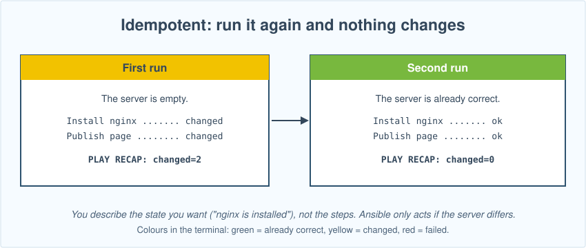

# Week 12 Lecture: Configuration Management with Ansible

Follow this guide from top to bottom. You type every command in a real terminal **on your own laptop**: Terminal on macOS, your Linux terminal, or the **Ubuntu (WSL 2) app** on Windows. Ansible does not run in plain Windows PowerShell. You need Docker running (see [How to install Docker](../week09/W09_Lecture_Containers.md#how-to-install-docker) in Week 9) and Ansible installed (see [Setup](#setup)).

## Setup

Install Ansible once. It goes in a **Python virtual environment**: a private folder of Python packages that does not disturb the rest of your system. Open the block for your system:

<details open>
<summary>Windows: Ubuntu (WSL 2) app, or Ubuntu / Debian Linux</summary>

```bash
sudo apt update && sudo apt install -y python3 python3-venv python3-pip  # Install Python and the virtual environment tool.
```

</details>

<details>
<summary>macOS</summary>

Python 3 comes with the developer tools. **Do not run the `apt` command**: macOS does not have `apt`. Check Python:

```bash
python3 --version  # Must print a version. If it says command not found, run: xcode-select --install
```

</details>

Then, on every system (Windows, macOS and Linux):

```bash
python3 -m venv ~/netops-venv  # Create the virtual environment in your home folder.
```

```bash
source ~/netops-venv/bin/activate  # Activate it. Your prompt now starts with (netops-venv). Do this in every new terminal before Week 12 work.
```

```bash
pip install ansible-core docker pyyaml  # Install Ansible, the Docker library it uses, and PyYAML.
```

```bash
ansible-galaxy collection install community.docker  # Install the collection that lets Ansible talk to Docker containers.
```

```bash
ansible --version | head -1  # Ansible must answer with a version number.
```

```bash
docker ps  # Docker must answer with a table (it can be empty). If it shows an error, start Docker Desktop and wait until it is running.
```

## How to follow this guide

- Every grey box is **one command** (or one file you create). Everything after the `#` on the first line is a comment that says what the command does. Copy the whole box, paste it into the terminal, press Enter, then go to the next box.
- Do the sections in order. All practice work happens in one folder, `~/ansible-practice`.
- In this guide your laptop is the control node, and your "servers" are **Docker containers** on it. Ansible treats them exactly like real servers.
- Close a terminal and you lose the virtual environment. Open a new one and run `source ~/netops-venv/bin/activate` and `cd ~/ansible-practice`.

## The big picture

A machine can be created with Vagrant, in the cloud, or with Terraform. A new machine is **empty**. Before it is useful, someone must install software, copy files, create users, change settings and start services. Doing that by logging in to each machine is slow, and no two machines end up exactly the same. With 3 machines it is annoying. With 300 it is impossible.

**Configuration management** means writing down how a machine must be set up, and letting a tool do it on every machine. **Ansible** is the tool we use.


| | Terraform (Week 11) | Ansible (today) |
|---|---|---|
| Job | **Provision**: create servers and networks | **Configure**: set up what is inside the servers |
| Example | "I want 3 servers" | "Every web server has nginx and this home page" |
| Remembers | A state file | Nothing. It asks the server each time. |

You use both together: Terraform builds the servers, then Ansible sets them up.

## What is Ansible?


Ansible is a free, open-source tool that automates the setup and management of servers, network devices and applications. You describe what you want in a file, and Ansible makes the machines match it.

### A short history

| Year | What happened |
|---|---|
| 2012 | Michael DeHaan, who had earlier built the tools Cobbler and Func, released Ansible. He wanted automation that is simpler than Puppet and Chef. |
| 2013-2014 | It became popular because it is simple, needs no agent on the servers, and uses YAML. |
| 2015 | Red Hat bought AnsibleWorks, the company behind Ansible. |
| 2016 | Red Hat added Ansible Tower: a web interface with central control for teams. |
| 2019 | Tower grew into the Ansible Automation Platform. |
| Today | Used for Linux administration, network automation, cloud infrastructure, application deployment and DevOps work. The core project is still open source. |

Ansible runs on **one machine** (the control node) and changes **many servers** (the managed nodes). Three properties make it simple:

| Property | Meaning |
|---|---|
| **Agentless** | You install nothing on the servers except Python. Ansible connects from the control node (with SSH on real servers, through Docker in our practice), runs a small program, and removes it. |
| **Push** | You run Ansible, and it pushes the changes. Nothing happens until you run it. |
| **Idempotent** | You describe the **state** you want ("nginx is installed"). If the server is already like that, Ansible changes nothing. You can run the same file ten times with the same result. |

Everything you write is in **YAML**, a plain text format made of `key: value` pairs and lists. Indentation matters: use spaces, never tabs.

**Why people adopted it:** 
- it is idempotent. This is why it is safe to run Ansible again after a failure, or to run it on a server that is half configured.
- it is playbooks are readable YAML.
- And it is agentless (no Ansible program runs on the managed machines; on Linux it uses SSH). 



### Terminology

| Word | Meaning |
|---|---|
| **Control node** | The machine where Ansible runs and from which you give the commands. It can be a laptop, a workstation or a server. In our practice it is your laptop. |
| **Managed node** | A server that Ansible configures. Today: a Docker container. |
| **Inventory** | The list of managed nodes, put into groups |
| **Module** | A ready-made tool that does one job (e.g. `apt` installs packages, `copy` copies a file, `service` manages services) |
| **Task** | One call of a module, with a name |
| **Handler** | is a special type of task that runs only when another task explicitly notifies it that a change has occurred, commonly used for operations that should happen only when necessary (e.g. restarting a service after its configuration changes.) |
| **Play** | A list of tasks that run on one group of servers |
| **Playbook** | A YAML file with one or more plays |
| **Variable** | A named value you can reuse |
| **Fact** | Information Ansible reads from a server: operating system, memory, address |

### Hands-on: servers and an inventory

#### Create three servers

Create the practice folder:

```bash
mkdir -p ~/ansible-practice && cd ~/ansible-practice  # Create the practice folder and move into it.
```

Start three containers. Each is a small Debian server that does nothing but stay alive:

```bash
docker run -d --name web1 debian:bookworm-slim sleep infinity  # The first web server.
```

```bash
docker run -d --name web2 debian:bookworm-slim sleep infinity  # The second web server.
```

```bash
docker run -d --name db1 debian:bookworm-slim sleep infinity  # A database server.
```

```bash
docker ps --format "table {{.Names}}\t{{.Status}}"  # Three containers are running.
```

#### Write the inventory

The inventory lists the servers and puts them in groups. A name in square brackets starts a group:

```bash
cat > inventory.ini <<'EOF'
[web]
web1
web2

[db]
db1

[all:vars]
ansible_connection=community.docker.docker
ansible_python_interpreter=/usr/bin/python3
EOF
```

| Line | Meaning |
|---|---|
| `[web]` | Starts a **group** called `web`. Every name below it, until the next group, belongs to it. |
| `web1`, `web2` | Two servers in the `web` group. Each name is a **container name** (the `--name` you gave to `docker run`). |
| `[db]` | Starts a second group called `db`. |
| `db1` | One server in the `db` group. |
| `[all:vars]` | Starts a block of **variables** for the group `all`. `all` is built in and contains every server. |
| `ansible_connection=community.docker.docker` | How to connect: through Docker, not SSH. On real servers you leave this out and Ansible uses SSH. |
| `ansible_python_interpreter=/usr/bin/python3` | Where Python is on the servers. Ansible runs its modules with it. |

Blank lines only make the file easier to read. A server can be in more than one group.

```bash
ansible-inventory -i inventory.ini --graph  # Show the groups as a tree: @web holds web1 and web2, @db holds db1.
```

#### The first command fails, on purpose

```bash
ansible -i inventory.ini all -m ping  # Try the ping module on all servers. It FAILS.
```

You see `The module interpreter '/usr/bin/python3' was not found`. Ansible modules are small Python programs. Ansible copies one to the server and runs it, so **the server needs Python**. A fresh Debian container has none.

The `raw` module runs a plain shell command and needs no Python, so we use it to prepare the servers:

```bash
ansible -i inventory.ini all -m raw -a "apt-get update -qq && apt-get install -y -qq python3 python3-apt"  # Install Python on every server with the raw module. It takes about a minute.
```

```bash
ansible -i inventory.ini all -m ping  # Now it works: every server answers SUCCESS with "ping": "pong".
```

The `ping` module is not a network ping. It checks that Ansible can connect and run Python on the server.

To avoid typing `-i inventory.ini` every time, create a config file in this folder:

```bash
cat > ansible.cfg <<'EOF'
[defaults]
inventory = inventory.ini
retry_files_enabled = False
EOF
```

From now on you can type `ansible all -m ping`.

## Modules and ad hoc commands

### What is a module?

A **module** is a small program that does one job on a server: install a package, copy a file, create a user, start a service. Ansible copies the module to the server, runs it, reads the result, and removes it. Every task in a playbook and every ad hoc command uses a module, so learning Ansible mostly means learning modules.

Most modules are **idempotent**: they check the current state first and change something only when it is different. Read the manual of any module with `ansible-doc MODULE`, for example `ansible-doc apt`.

### Core modules (`ansible.builtin`)

These come with Ansible itself, with no extra installation. Their full name is `ansible.builtin.NAME` (for example `ansible.builtin.apt`), and the short name works too.

**A. System administration**

| Module | What it does |
|---|---|
| `user` | Creates, changes or removes a Linux user: name, home folder, shell, groups, password hash. |
| `group` | Creates or removes a Linux group. |
| `hostname` | Sets the host name of the machine. |
| `service` | Starts, stops, restarts or enables a service. It needs a service manager, so it does not work in our containers. |
| `systemd_service` | The same for systemd, with systemd options such as `daemon_reload`. It is the new name of `systemd`. Real servers only. |
| `reboot` | Restarts the machine, waits until it is back, and then continues the playbook. |
| `cron` | Creates, changes or removes a scheduled job (a line in the crontab). |
| `file` | Creates a folder, sets the owner and permissions of a file, makes a link, or deletes a file. It never changes the content of a file. |

**B. Package management**

| Module | What it does |
|---|---|
| `apt` | Installs, upgrades or removes packages on Debian and Ubuntu. `update_cache=yes` refreshes the package list first. This is the module of our containers. |
| `dnf` | The same on Fedora and RHEL. |
| `dnf5` | The same for the newer DNF5 package manager. |
| `yum_repository` | Adds or removes a repository definition, which tells YUM or DNF where to download packages from. |
| `package` | A generic module: it looks at the system and calls `apt`, `dnf` or the right tool. One playbook then works on different systems. |
| `pip` | Installs Python packages, optionally into a virtual environment. |

**C. Files and configuration**

| Module | What it does |
|---|---|
| `copy` | Copies a file from the control node to the server, or writes text you give it (`content=`) into a file. |
| `template` | Fills a Jinja2 template (a file with `{{ variables }}`) with the variables of each server and copies the result. |
| `lineinfile` | Makes sure one line is in a file, changes it if it exists with different text, or removes it. |
| `blockinfile` | Makes sure a block of several lines is in a file, between marker comments. |
| `replace` | Replaces every match of a regular expression in a file. |
| `fetch` | The opposite of `copy`: copies a file from the server back to the control node. |
| `stat` | Reads information about a path: does it exist, size, owner, permissions. It changes nothing. Use it with a condition. |
| `find` | Searches for files by name, age or size and returns the list. |
| `unarchive` | Unpacks a `.zip` or `.tar.gz` on the server. |
| `get_url` | Downloads a file from a URL to the server, optionally checking its checksum. |
| `assemble` | Joins many small files from a folder into one configuration file. |

**D. Running commands**

| Module | What it does |
|---|---|
| `command` | Runs a program on the server without a shell, so no pipes, `>` or `$VARIABLES`. Add `creates:` or `removes:` to make it skip when the result already exists. |
| `shell` | Runs the command through a shell, so pipes and redirects work. It is not idempotent: it always reports changed. |
| `script` | Copies a script from the control node, runs it on the server, and nothing needs to be installed beforehand. |
| `raw` | Sends the text over SSH and runs it. It does not need Python on the server, so use it to install Python itself. |
| `expect` | Runs a command and answers its questions (prompts). Needs the Python package `pexpect` on the server. |

Prefer a real module (`apt`, `copy`, `user`) over `command` or `shell`. A real module knows the state and is idempotent. `command` and `shell` cannot know, so they always report changed.

**E. Networking and connectivity**

| Module | What it does |
|---|---|
| `ping` | Checks that Ansible can connect and run Python on the server. It is not the network `ping`: it answers `pong`. |
| `uri` | Makes an HTTP or HTTPS request (GET, POST...) and checks the status code or the answer. Good for testing an API or a web page. |
| `wait_for` | Waits until a port is open, a file exists, or a text appears in a file. Use it after you start a service. |
| `wait_for_connection` | Waits until the host can be reached again, for example after a reboot. |
| `iptables` | Adds or removes a firewall rule on Linux. |

`get_url` (in section C) also belongs here, because it downloads over HTTP and HTTPS.

**F. Playbook execution and control**

| Module | What it does |
|---|---|
| `debug` | Prints a message or the value of a variable while the playbook runs. |
| `assert` | Stops with an error if a condition is false. A way to check your own assumptions. |
| `fail` | Stops the playbook with an error message you write. |
| `set_fact` | Creates a variable while the play runs, from a value or a calculation. |
| `include_tasks` | Loads a file of tasks while the play runs (dynamic). Good with loops and conditions. |
| `import_tasks` | Loads a file of tasks before the play runs (static). The tasks are always read. |
| `include_role` | Runs a role at this point in the play (dynamic). |
| `import_role` | Adds a role to the play before it starts (static). |
| `pause` | Pauses the play for some seconds or until you press a key. |
| `meta` | Controls the play itself, for example `flush_handlers` runs the waiting handlers now, and `end_play` stops the play without an error. |

`mount` (manage filesystem mounts) is not a core module. It comes from the `ansible.posix` collection.

### Collection modules

Beyond the core set, **collections** add modules for one product or area. A collection is installed once with `ansible-galaxy collection install NAME`. Today you installed one, `community.docker`, which lets Ansible reach Docker containers.

| Collection | Used for | Example modules |
|---|---|---|
| `community.docker` | Docker automation | `docker_container`, `docker_image` |
| `ansible.posix` | Linux administration | `mount`, `firewalld`, `sysctl`, `authorized_key` |
| `community.general` | General system automation | `timezone`, `nmcli` |
| `amazon.aws` | Amazon Web Services | `ec2_instance`, `s3_bucket` |
| `kubernetes.core` | Kubernetes | `k8s`, `k8s_info` |
| `cisco.ios` | Cisco IOS routers and switches | `ios_config`, `ios_command` |
| `arista.eos` | Arista EOS switches | `eos_config`, `eos_command` |
| `ansible.netcommon` | Network devices in general | `netconf_get`, `netconf_rpc` |
| `community.vmware` | VMware | VM and vSphere management |

Find more with `ansible-galaxy collection list` and on [galaxy.ansible.com](https://galaxy.ansible.com).

### Ad hoc commands

An **ad hoc command** runs one module once, from the command line, without writing a playbook. The form is `ansible GROUP -m MODULE -a "ARGUMENTS"`. Here is every part of one:

```text
ansible db -m apt -a "name=tree state=present update_cache=yes" --become
   |     |    |    |   |                                         |
   |     |    |    |   |                                         +-- run with administrator rights (sudo)
   |     |    |    |   +-- the arguments of the module, as name=value pairs
   |     |    |    +-- -a: "arguments" follow
   |     |    +-- the module: what to do
   |     +-- -m: "module" follows
   +-- the pattern: which servers (a group, a host, or all). The inventory says who they are.
```

| Part | Meaning |
|---|---|
| `ansible` | The ad hoc program. Playbooks use `ansible-playbook` instead. |
| `db` | The **pattern**: a group name, a host name, `all`, or a combination such as `web:db`. It is looked up in the inventory. |
| `-m apt` | The **module** to run. If you leave it out, Ansible uses `command`. |
| `-a "..."` | The **arguments** of the module. Each module has its own. See them with `ansible-doc apt`. |
| `--become` (`-b`) | Run with administrator rights (like `sudo`). Needed to install packages on a real server. In our containers we are already root. |
| `-i FILE` | Use this inventory file. Our `ansible.cfg` already sets it, so we skip it. |
| `-u USER` | Connect as this user. |
| `--limit HOST` (`-l`) | Run only on this host, even if the pattern is wider. |
| `--check` | Show what would change, and change nothing. |
| `-f N` | Run on N servers at the same time (default 5). |
| `-v`, `-vvv` | Show more detail. Use it to see why a connection fails. |

Ansible does the following for each server: connect, copy the module, run it, collect the answer as JSON, remove the module, and print one coloured result. Different servers can answer at different speeds, because they run in parallel.

Now try it:

```bash
ansible web -m command -a "hostname"  # Run a command on the web group only. It answers with the container's name.
```

`command` always prints **CHANGED** (yellow), because Ansible cannot know whether a free-form command changed anything. Modules that describe a state, like `apt`, know better.

```bash
ansible all -m setup -a "filter=ansible_distribution*"  # Read facts about the operating system of every server.
```

```bash
ansible db -m apt -a "name=tree state=present update_cache=yes"  # Install the package tree on the db group. The first time it says CHANGED.
```

```bash
ansible db -m apt -a "name=tree state=present"  # Run the same command again. It says SUCCESS with "changed": false. Nothing to do: idempotent.
```

```bash
ansible db -m copy -a "content='hello from ansible\n' dest=/tmp/hello.txt"  # Create a file on the db server with the copy module.
```

```bash
ansible db -m command -a "cat /tmp/hello.txt"  # Read the file back from the server.
```

Colour code in the terminal: **green** = already correct, **yellow** = changed something, **red** = failed.

#### The `state` argument

You used `state=present` in the commands above. Here is what it means.

Most modules have an argument called `state`. It says **what condition you want the thing to be in**, not what action to perform. You do not say "install nginx". You say "nginx is present", and Ansible installs it only if it is missing.

| `state` | Meaning | Example |
|---|---|---|
| `present` | It must exist. Create or install it if it is missing. | `apt` with `name=nginx state=present` installs nginx if it is not there. |
| `absent` | It must not exist. Remove it if it is there. | `file` with `state=absent` deletes the file. |
| `latest` | It must exist and be the newest version. | `apt` with `state=latest` also upgrades an old package. |
| `directory` | It must be a folder. | `file` with `state=directory` creates the folder. |
| `started`, `stopped`, `restarted` | A service must be running, stopped, or restarted now. | `service` with `state=started`. |

If the thing is already in the wanted condition, Ansible does nothing and reports `ok`. This is why `state` is the heart of idempotency. The values that exist depend on the module, so check `ansible-doc MODULE`.

Ad hoc commands are good for a quick check or a one-time job. For real work you write the same tasks in a playbook, because a file can be saved, reviewed and repeated.

## Your first playbook

A playbook describes the state you want. Create one that installs curl everywhere, and installs nginx (a web server) on the web group:

```bash
cat > site.yml <<'EOF'
---
- name: Baseline for every server
  hosts: all
  tasks:
    - name: Install curl
      ansible.builtin.apt:
        name: curl
        state: present

- name: Web servers
  hosts: web
  tasks:
    - name: Install nginx
      ansible.builtin.apt:
        name: nginx
        state: present

    - name: Publish a home page
      ansible.builtin.copy:
        content: "<h1>Hello from {{ inventory_hostname }}</h1>\n"
        dest: /var/www/html/index.html
        mode: "0644"

    - name: Make sure nginx is running
      ansible.builtin.command:
        cmd: nginx
        creates: /run/nginx.pid
EOF
```


Read it:

- A playbook is a YAML **list** of plays. Each play starts with `- name:`.
- `hosts:` picks the group from the inventory. `tasks:` is a list of tasks.
- A task has a `name` (for humans) and one module with its arguments.
- `{{ inventory_hostname }}` is a **variable**. Ansible replaces it with the server name.
- Containers have no service manager, so the last task starts nginx directly. `creates: /run/nginx.pid` tells Ansible to skip the command when that file exists. It is a simple way to make a command idempotent.

Check it, then run it:

```bash
ansible-playbook --syntax-check site.yml  # Check the YAML and the structure without running anything. It answers: playbook: site.yml
```

```bash
ansible-playbook site.yml  # Run the playbook. Each task shows ok or changed for each server. The last block is the PLAY RECAP.
```

**You should see** `changed` for the installs on this first run. Run it again:

```bash
ansible-playbook site.yml  # The second run shows changed=0 for every server. Idempotent.
```

```bash
ansible web -m uri -a "url=http://localhost return_content=yes"  # Ask nginx on each web server for its page, from inside the server.
```

**You should see** `Hello from web1` and `Hello from web2`.

### Check mode: look before you change

On a real server, running a playbook changes things. You often want to know **what would change** before you let it. **Check mode** is a dry run: Ansible goes through every task and reports what it would do, but changes nothing.

Here is a situation to practise on. Someone logs in to **web1** and deletes the home page by hand. The playbook says the page must exist, so web1 now differs from what the playbook describes. We will let Ansible find that out, without fixing it yet.

**Step 1.** Break web1 on purpose, with an ad hoc command:

```bash
ansible web1 -m file -a "path=/var/www/html/index.html state=absent"  # Delete the home page on web1 only. It answers CHANGED: the file existed and is now gone.
```

The parts: `web1` is the server, `file` is the module, and `state=absent` means "this path must not exist". It is the opposite of `state=present`.

**Step 2.** Ask Ansible what it would change:

```bash
ansible-playbook site.yml --check --diff  # Dry run: show what WOULD change and how, and change nothing.
```

Two options do the work:

| Option | What it does |
|---|---|
| `--check` (`-C`) | Turns on check mode. Each task still looks at the server and decides `ok` (already correct) or `changed` (would change), but it does not make the change. |
| `--diff` (`-D`) | For tasks that change a file, prints the difference: lines with `-` would be removed, lines with `+` would be added. |

You can use each one alone. Together they answer "what would change, and what exactly would the file look like?"

**Step 3.** Read the answer. The output looks like this (shortened):

```text
TASK [Publish a home page] *****************************
--- before
+++ after
@@ -0,0 +1 @@
+<h1>Hello from web1</h1>

changed: [web1]
ok: [web2]

PLAY RECAP *********************************************
web1 : ok=6  changed=1  unreachable=0  failed=0 ...
web2 : ok=6  changed=0  unreachable=0  failed=0 ...
```

How to read it:

- `TASK [Publish a home page]` is the one task that found a difference. Every other task said `ok` on both servers.
- `changed: [web1]` means web1 does not match the playbook, so this task **would** change it. `ok: [web2]` means web2 is already correct.
- The `--- before` and `+++ after` block is the diff. The file is missing now, so "before" is empty, and the only line in "after" is `+<h1>Hello from web1</h1>`: the page that would be created.
- In the recap, `changed=1` on web1 and `changed=0` on web2 sum it up. Nothing was changed, even though it says `changed`: in check mode the word means "would change".

Check the server to be sure that nothing happened:

```bash
ansible web1 -m stat -a "path=/var/www/html/index.html"  # The answer says "exists": false. The page is still missing, so check mode did not repair it.
```

**Step 4.** Now run it for real:

```bash
ansible-playbook site.yml  # Run it for real. Ansible repairs web1 (changed=1) and leaves web2 alone (changed=0).
```

Check mode is the Ansible version of `terraform plan`. Use it before every run on real servers. It is also a good test: if a playbook that is already applied shows `changed` in check mode, something on the server drifted from what the playbook says.

## Variables and templates

Hard-coded values make a playbook useful for only one case. Put values in **variable files**, and fill them into a **template**: a file with `{{ ... }}` holes, written in a language called **Jinja2**.

```bash
mkdir -p group_vars templates  # Folders Ansible reads by name: group_vars holds variables, templates holds templates.
```

```bash
printf 'site: ott-dc1\n' > group_vars/all.yml  # A variable for every server.
```

```bash
printf 'page_title: Demo Web Server\n' > group_vars/web.yml  # A variable for the web group only.
```

The file name must match the group name: `group_vars/web.yml` applies to the `web` group, and `group_vars/all.yml` applies to everyone.

```bash
cat > templates/index.html.j2 <<'EOF'
<h1>{{ page_title }}</h1>
<p>Site: {{ site }}</p>
<p>Served by: {{ inventory_hostname }} ({{ ansible_facts['distribution'] }} {{ ansible_facts['distribution_version'] }})</p>
EOF
```

`ansible_facts['distribution']` is a **fact**: Ansible reads it from the server when a play starts (that is the "Gathering Facts" task in the output).

Now use the template instead of `copy`, and add a **handler**. Replace `site.yml` with this version:

```bash
cat > site.yml <<'EOF'
---
- name: Baseline for every server
  hosts: all
  tasks:
    - name: Install curl
      ansible.builtin.apt:
        name: curl
        state: present

- name: Web servers
  hosts: web
  tasks:
    - name: Install nginx
      ansible.builtin.apt:
        name: nginx
        state: present

    - name: Publish the home page from a template
      ansible.builtin.template:
        src: index.html.j2
        dest: /var/www/html/index.html
        mode: "0644"
      notify: Reload nginx

    - name: Make sure nginx is running
      ansible.builtin.command:
        cmd: nginx
        creates: /run/nginx.pid

  handlers:
    - name: Reload nginx
      ansible.builtin.command:
        cmd: nginx -s reload
EOF
```

A **handler** is a task that waits. `notify: Reload nginx` calls it, but **only if the task that notifies it changed something**. A web server needs a reload after its files change, and a reload on every run would be wasteful. Handlers run once, at the end of the play.

```bash
ansible-playbook site.yml  # Run it. The template task changes, and then RUNNING HANDLER [Reload nginx] appears.
```

```bash
ansible-playbook site.yml  # Run it again. Nothing changes, so the handler does not run.
```

```bash
ansible web -m uri -a "url=http://localhost return_content=yes" | grep -E "Site|Served|Demo"  # The page now shows the variables and the facts.
```

Change a variable and watch the handler:

```bash
printf 'page_title: Welcome to the Demo\n' > group_vars/web.yml  # Change the page title in the variable file.
```

```bash
ansible-playbook site.yml  # The page changes, so the handler runs again. You edited a variable, not the playbook.
```

Override a variable from the command line:

```bash
ansible-playbook site.yml -e site=ott-dc2 --check --diff  # Preview a change of the site name. Nothing is applied.
```

**Variable priority** (low to high), simplified: `group_vars/all` < `group_vars/GROUP` < variables in the playbook < `-e` on the command line.

## Loops and conditions

A task can repeat with a **loop**, and can be skipped with a **condition** (`when`).

```bash
cat > extras.yml <<'EOF'
---
- name: Loops and conditions
  hosts: all
  tasks:
    - name: Install several small tools
      ansible.builtin.apt:
        name: "{{ item }}"
        state: present
      loop:
        - tree
        - less
        - htop

    - name: Say which servers are web servers
      ansible.builtin.debug:
        msg: "{{ inventory_hostname }} is a web server"
      when: "'web' in group_names"
EOF
```

```bash
ansible-playbook extras.yml  # The loop runs once per item. The message appears for web1 and web2, and db1 shows "skipping".
```

`group_names` is a built-in variable: the list of groups the current server belongs to.

## Roles

When a playbook grows, you split it. A **role** is a folder with a fixed layout: one role for one job, for example "a web server". A playbook then just lists the roles it needs, and you can reuse a role in other projects.

Move the web server work into a role called `webserver`:

```bash
mkdir -p roles/webserver/tasks roles/webserver/handlers roles/webserver/templates  # The standard role layout: tasks, handlers and templates.
```

```bash
mv templates/index.html.j2 roles/webserver/templates/  # The template belongs to the role now.
```

```bash
cat > roles/webserver/tasks/main.yml <<'EOF'
---
- name: Install nginx
  ansible.builtin.apt:
    name: nginx
    state: present

- name: Publish the home page from a template
  ansible.builtin.template:
    src: index.html.j2
    dest: /var/www/html/index.html
    mode: "0644"
  notify: Reload nginx

- name: Make sure nginx is running
  ansible.builtin.command:
    cmd: nginx
    creates: /run/nginx.pid
EOF
```

```bash
cat > roles/webserver/handlers/main.yml <<'EOF'
---
- name: Reload nginx
  ansible.builtin.command:
    cmd: nginx -s reload
EOF
```

Ansible reads `tasks/main.yml` and `handlers/main.yml` by name, and finds the template in `templates/`. Now the playbook becomes short:

```bash
cat > site.yml <<'EOF'
---
- name: Baseline for every server
  hosts: all
  tasks:
    - name: Install curl
      ansible.builtin.apt:
        name: curl
        state: present

- name: Web servers
  hosts: web
  roles:
    - webserver
EOF
```

```bash
ansible-playbook site.yml  # Same result as before: changed=0, because the servers are already correct. Only the way we wrote it changed.
```

```bash
ansible-playbook site.yml --list-tasks  # List the tasks. The role's tasks are shown with the prefix "webserver :".
```

## Try it yourself: the database server

Add a play for the `db` group at the end of `site.yml` that does three things. Use these modules and look each one up with `ansible-doc MODULE` if you need its options:

| Goal | Module |
|---|---|
| Create a user called `appuser` with the shell `/bin/bash` | `ansible.builtin.user` |
| Create the folder `/srv/appdata`, owned by `appuser`, with mode `0750` | `ansible.builtin.file` (with `state: directory`) |
| Write the line `role=database site=ott-dc1` into `/etc/server-role`, using the `site` variable | `ansible.builtin.lineinfile` (with `create: true`) |

Run the playbook twice. The second run must show `changed=0`.

<details>
<summary>Show the solution</summary>

Add this to the end of `site.yml`:

```yaml
- name: Database servers
  hosts: db
  tasks:
    - name: Create the application user
      ansible.builtin.user:
        name: appuser
        shell: /bin/bash

    - name: Create a data folder owned by that user
      ansible.builtin.file:
        path: /srv/appdata
        state: directory
        owner: appuser
        mode: "0750"

    - name: Label the role of this server
      ansible.builtin.lineinfile:
        path: /etc/server-role
        line: "role=database site={{ site }}"
        create: true
        mode: "0644"
```

Check it:

```bash
ansible db -m command -a "cat /etc/server-role"  # It shows role=database site=ott-dc1.
```

</details>

## Clean up

```bash
docker rm -f web1 web2 db1  # Delete the three containers (the servers). Your files stay.
```

## Practice questions

<details>
<summary>1. What does "idempotent" mean? Give an example from today.</summary>

Running the same playbook again gives the same result and changes nothing that is already correct. Example: the second run of `site.yml` showed `changed=0`, and the `apt` command with `state=present` said `"changed": false` the second time.

</details>

<details>
<summary>2. Why did the first <code>ping</code> fail, and why did <code>raw</code> work?</summary>

Ansible modules are Python programs that run on the server, and the fresh container had no Python. The `raw` module sends a plain shell command and needs no Python, so it could install Python.

</details>

<details>
<summary>3. When does a handler run?</summary>

Only when a task that notifies it reports <em>changed</em>, and then once at the end of the play. In the second run nothing changed, so <code>Reload nginx</code> did not run.

</details>

<details>
<summary>4. You add a fourth web server. Which file do you change, and do you edit the playbook?</summary>

You add its name under <code>[web]</code> in <code>inventory.ini</code>. The playbook stays the same, because it works on the group <code>web</code>, not on single servers.

</details>

<details>
<summary>5. What is the difference between Terraform and Ansible?</summary>

Terraform creates the infrastructure (servers, networks) and keeps a state file. Ansible configures what is inside the servers (packages, files, users, services) and keeps no state: it asks each server.

</details>

## Cheat sheet

| Command | What it does |
|---|---|
| `ansible GROUP -m MODULE -a "ARGS"` | Run one module once (ad hoc) |
| `ansible all -m ping` | Check that Ansible can reach every server |
| `ansible-playbook FILE` | Run a playbook |
| `ansible-playbook FILE --check --diff` | Preview a run without changing anything |
| `ansible-playbook FILE -e name=value` | Override a variable |
| `ansible-playbook FILE --syntax-check` | Check the YAML |
| `ansible-playbook FILE --list-tasks` | List the tasks of a playbook |
| `ansible-inventory --graph` | Show the groups as a tree |
| `ansible-doc MODULE` | Read the manual of a module |

For the full list of modules and what each one does, see [Modules and ad hoc commands](#modules-and-ad-hoc-commands).

## If something goes wrong

| Message or symptom | Cause and fix |
|---|---|
| `ansible: command not found` | The virtual environment is not active: `source ~/netops-venv/bin/activate`. |
| `couldn't resolve module/action 'community.docker...'` or `connection plugin ... not found` | Install the collection: `ansible-galaxy collection install community.docker`. |
| `Failed to connect ... No such container` | The container name in the inventory is wrong or the container is stopped. Check `docker ps`. |
| `The module interpreter '/usr/bin/python3' was not found` | The server has no Python yet. Run the `raw` command from the inventory section. |
| `Could not import python modules: apt, apt_pkg` | `python3-apt` is missing. Run the `raw` command again. |
| `Cannot connect to the Docker daemon` | Docker Desktop is not running. Start it and wait until it says running. |
| `[WARNING]: Ansible is being run in a world writable directory ... ignoring ansible.cfg` | You are in a folder under `/mnt/c` (Windows). Work in your Linux home folder `~`. |
| YAML error: `mapping values are not allowed here` or `could not find expected ':'` | Indentation or a missing space after a colon. The message gives the line number. |
| A task shows `changed` on every run | The task is not idempotent. A `command` without `creates:` always reports changed. |
| `'site' is undefined` | `group_vars/all.yml` is missing or not in the same folder as `inventory.ini`. |
| Apple silicon: image or package problems | The Debian image has an ARM build. Make sure you did not add `--platform linux/amd64`. |

## Summary

- Ansible configures many servers from one control node. It is agentless: the servers only need Python.
- The **inventory** lists servers in groups. A **playbook** holds **plays**, and a play holds **tasks**. Each task calls one **module**.
- Ansible is **idempotent**: the second run changes nothing. `--check --diff` previews a run.
- **Variables** live in `group_vars`. **Templates** (Jinja2) turn variables and facts into files. **Handlers** run only when something changed.
- **Loops** and **conditions** repeat or skip tasks. **Roles** split a big playbook into reusable parts.
- Terraform creates the servers. Ansible sets up what is inside them.

**Next:** the Week 12 lab (graded) configures three servers with your own seed. Then Practical Assessment 3 combines Docker, Terraform and Ansible.
